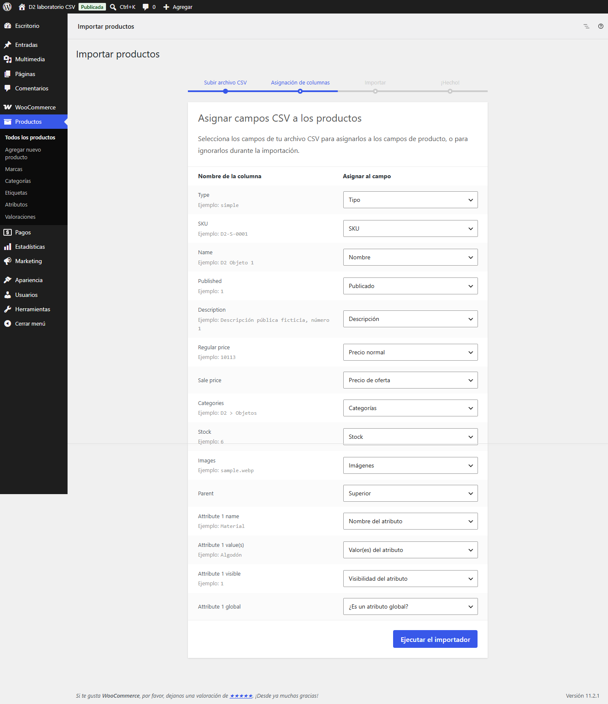
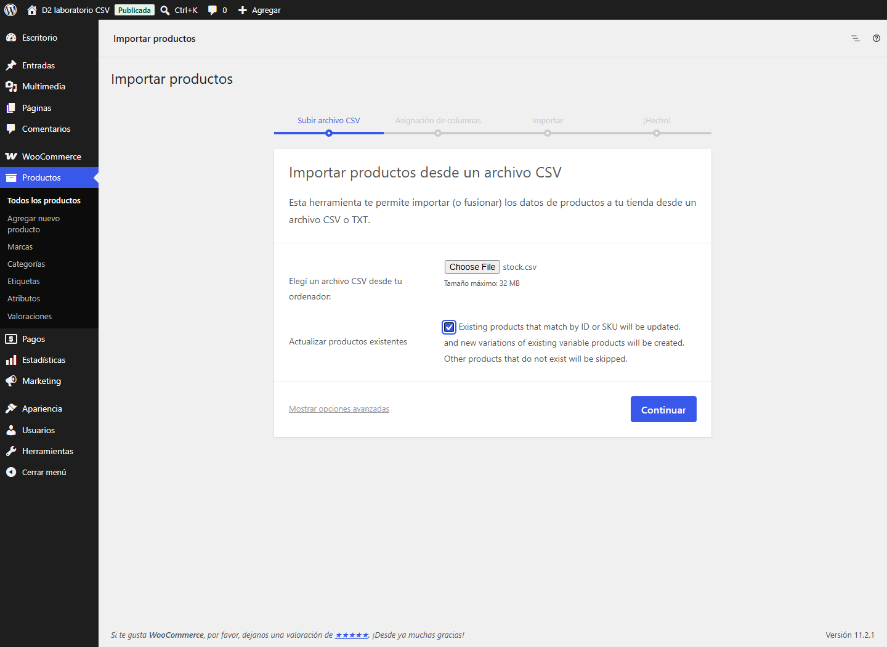
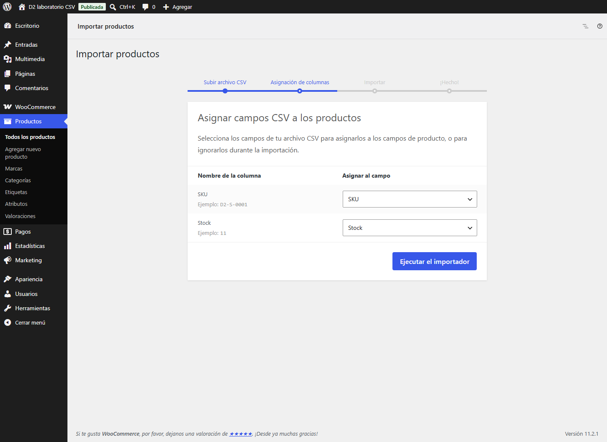
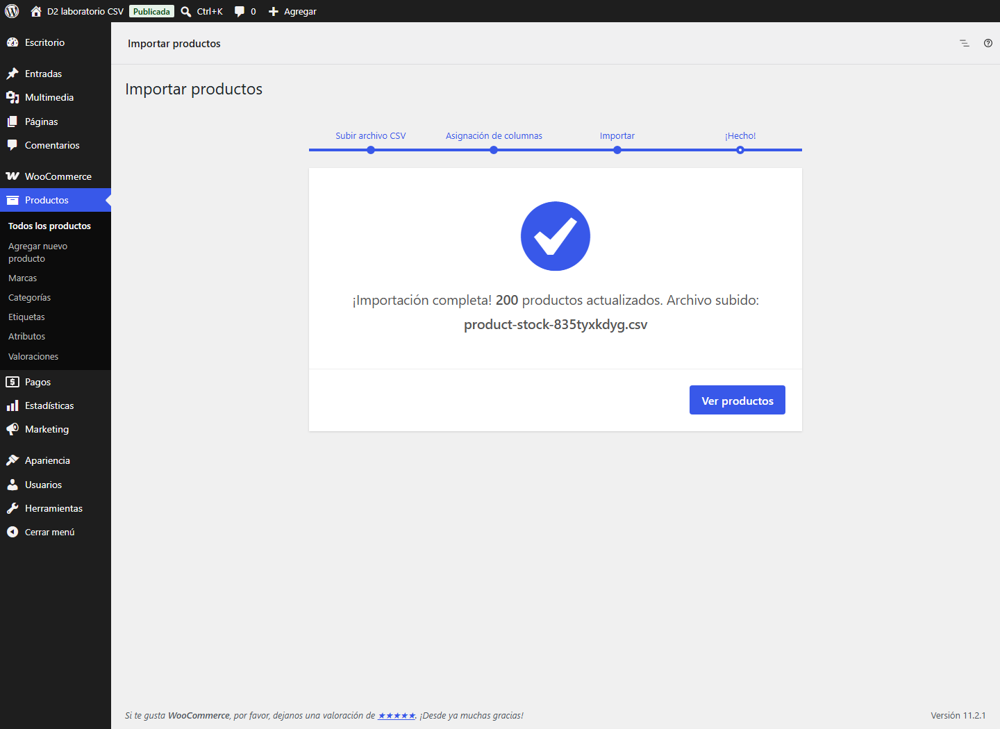
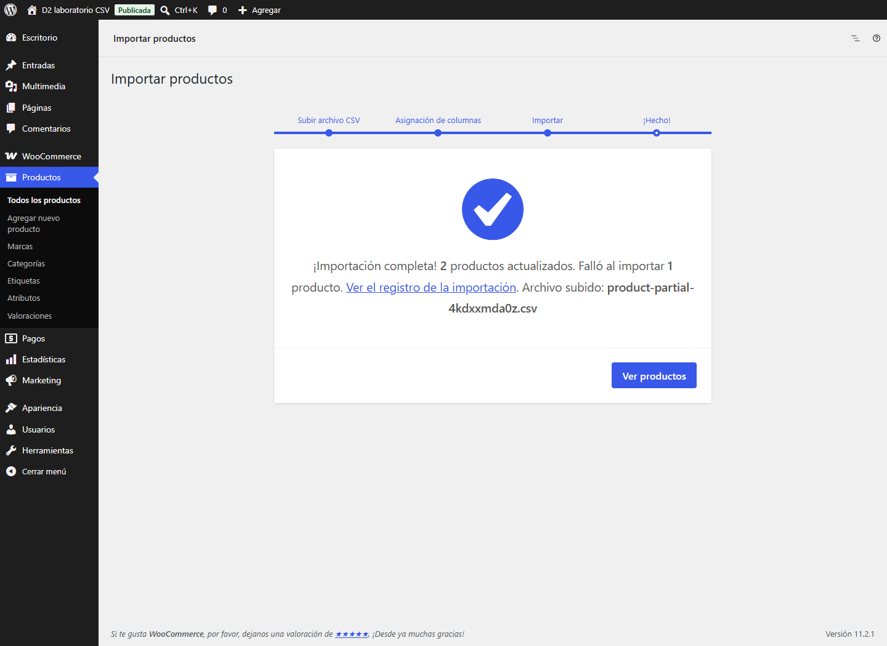

# Manual del vendedor — TRAMA y ORIGEN CASA

Preparado el **25/10/2026**. Esta guía explica la administración normal de WordPress y WooCommerce para una tienda pequeña. La revisión se realiza en laboratorios locales con datos ficticios: todavía no hay una tienda publicada ni autorización para cobrar, enviar correos reales o cambiar Hostinger.

## Entrar y orientarse

En una tienda entregada, soporte te proporciona la dirección del panel, tu usuario y tu contraseña por un canal privado. La dirección termina en **`/wp-admin/`**. Ingresá con tu propia cuenta y cerrá sesión al terminar, sobre todo en equipos compartidos. No compartas contraseñas ni uses la cuenta técnica para el trabajo diario.

En esta revisión, los paneles para pruebas son [TRAMA vendedor](http://localhost:8192/wp-admin/) y [ORIGEN CASA vendedor](http://localhost:8193/wp-admin/). Requieren el equipo/laboratorio local y las cuentas privadas de QA; las credenciales no forman parte de este manual. Las instalaciones originales `8080`/`8082` se preservan. Las demos públicas D1 `8190`/`8191` bloquean deliberadamente el panel y las compras: ese aviso no representa el funcionamiento de una tienda normal.

La etiqueta **Publicada** que aparece en estas capturas es un estado dentro de WordPress. En estos laboratorios no significa que la tienda esté publicada en internet.

El panel es el de **WordPress y WooCommerce**. Tiene una presentación distinta de la tienda que ven tus compradores; no se necesita otro programa ni un panel diseñado desde cero.

| Para hacer esto | Buscar en el menú |
| --- | --- |
| Revisar ventas que necesitan atención | **WooCommerce → Pedidos** |
| Cambiar productos, precios o stock | **Productos → Todos los productos** |
| Preparar categorías y opciones comunes | **Productos → Categorías / Atributos** |
| Crear descuentos con código | **Marketing → Cupones** |
| Consultar resultados y fechas | **Estadísticas** |
| Atender una solicitud recibida | **WooCommerce → Arrepentimiento** |

No hace falta recorrer todo el menú. Para la operación diaria, empezá por Pedidos y Productos. La [colección de capturas](evidence/d1-seller/README.md) permite reconocer las pantallas de esta instalación; los rótulos exactos y los límites observados se registran en [la auditoría](d1-seller-experience-audit.md).

## Tu cuenta y la cuenta técnica

La cuenta **Shop Manager / Gestor de la tienda** sirve para administrar el comercio: catálogo, pedidos, descuentos, informes y solicitudes. También puede entrar a ajustes importantes de WooCommerce. Que un botón aparezca no significa que convenga usarlo sin revisar sus consecuencias.

La cuenta **Administrator / Administrador** queda para las tareas técnicas y la configuración general. El rol **Customer / Cliente** es para compradores: no administra el comercio.

Para el dueño que toma decisiones comerciales, Shop Manager evita utilizar a diario todos los poderes de Administrador. No es una cuenta restringida únicamente a cargar stock. Si un empleado sólo debe preparar pedidos o actualizar precios, acordá sus permisos con soporte antes de darle acceso. No cambies roles ni crees administradores para resolver un permiso faltante.

## Agregar un producto simple

Un producto simple se vende como una sola opción. Por ejemplo, un objeto sin tamaños ni acabados para elegir.

1. Entrá en **Productos** y elegí **Agregar nuevo producto**.
2. Escribí un nombre claro y una descripción en la pestaña **Visual**. Agregá una descripción corta si querés un resumen junto al precio; no hace falta usar la pestaña Código.
3. En **Datos del producto**, elegí **Producto simple**.
4. En **General**, ingresá el **Precio normal**. Comprobá la moneda y no escribas el signo `$` dentro del importe.
5. En **Stock**, usá un **SKU** propio y distinto para identificar el artículo. Si vas a controlar unidades, activá la gestión de inventario y escribí la cantidad real disponible. No habilites pedidos sin existencias salvo que el comercio haya decidido vender de esa forma.
6. Seleccioná una categoría. Agregá la imagen principal y, si corresponde, fotos adicionales de la galería. Usá imágenes del producto y un texto alternativo que lo describa.
7. Guardá primero como borrador si falta algo. Cuando esté completo, elegí **Publicar** y abrí su ficha en la tienda para comprobar título, foto, precio, categoría y disponibilidad.

Para que el artículo se pueda comprar necesita precio y disponibilidad. Fotos, descripción, categoría y SKU hacen que el catálogo sea comprensible y ordenado, aunque no todos esos campos sean exigidos por el formulario. No completes campos técnicos desconocidos al azar.

Referencia visual: [editor de producto simple QA](evidence/d1-seller/products-role-simple-editor.png). En una pantalla de escritorio, Datos del producto puede quedar más abajo: desplazate hasta ese recuadro para encontrar precio y stock.

## Cambiar un precio o hacer una oferta

En **Productos → Todos los productos**, buscá el nombre o SKU y abrí **Editar**. Para un producto simple, modificá **Precio normal** en Datos del producto → General y pulsá **Actualizar**. Comprobá después la ficha de la tienda.

Una oferta usa **Precio de oferta**, menor que el normal. El enlace **Vigencia** permite revisar sus fechas. Al terminar, retirala o comprobá su vencimiento; un cartel editorial de promoción no cambia precios por sí mismo.

En un producto variable, el precio se configura **en cada variación**. Cambiar un dato general del producto no garantiza que se hayan actualizado todas las combinaciones. Revisá las opciones afectadas antes de confirmar una modificación en lote.

## Agregar un producto con opciones

Un producto variable permite elegir combinaciones. En TRAMA pueden ser **Color y Talle**; en ORIGEN CASA, **Material, Acabado o Capacidad**, según el objeto. No todos los productos necesitan todos los atributos.

1. Creá el producto y seleccioná **Producto variable** en Datos del producto.
2. En **Atributos**, seleccioná las opciones comunes del catálogo o creá las que realmente necesitás. Si ya aparece una fila vacía, completala antes de agregar otra. Indicá los valores y marcá cuáles se usan para variaciones. Guardá los atributos.
3. Entrá en **Variaciones** y agregá sólo las combinaciones que vas a ofrecer. Generar todas puede crear muchas opciones inexistentes.
4. Abrí cada variación y comprobá sus atributos, precio, disponibilidad y cantidad. Agregá una imagen propia cuando haga falta distinguirla.
5. Guardá los cambios de variaciones y después **Publicar / Actualizar** el producto.
6. En la tienda, elegí las opciones como lo haría un comprador. Comprobá qué combinación está disponible y qué precio muestra antes de agregarla al carrito.

Una variación sin precio puede no aparecer disponible. Si cambiás un atributo después de crear combinaciones, revisá las variaciones: pueden quedar opciones incompletas. Para la primera carga conviene hacerlo acompañado por soporte; para reposición y precios, trabajá sobre las variaciones ya revisadas.

Referencias visuales: [remera con opciones](evidence/d1-seller/products-role-variable-editor.png), [stock por variación](evidence/d1-seller/products-role-variable-stock.png) y [jarra con Material/Capacidad](evidence/d1-seller/products-role-decor-stock.png). Son productos QA creados desde el panel para mostrar los dos tipos de catálogo.

Si el atributo se comparte entre muchos productos y querés usarlo en filtros del catálogo, conviene definirlo en **Productos → Atributos**, cargar sus términos y después seleccionarlo como atributo existente en las fichas. Un atributo escrito sólo para un producto puede servir a sus variantes, pero no reemplaza esa organización común. Revisá con soporte qué atributos y términos usa cada rubro.

## Cambiar stock, reponer o dejar de mostrar un producto

Para un simple, abrí **Stock** y ajustá la cantidad disponible. Para un variable con stock propio por combinación, abrí **Variaciones** y cambiá la cantidad de la opción correcta: por ejemplo Negro/M o Cerámica/Mate. Evitá sumar la misma existencia en el producto general y en cada variación sin una política clara.

Al recibir mercadería, contá las unidades y actualizá el stock. No supongas que el sistema conoce lo que hay en un local o depósito: sólo conoce las cantidades registradas y los cambios que producen los pedidos. La gestión de varios depósitos no está incluida en este alcance.

Si no se controlan cantidades para ese artículo, revisá su estado de stock. Si se controlan unidades, usá la cantidad correcta y verificá el resultado agotado. Los avisos de stock bajo dependen de los umbrales y de que el correo de la tienda esté correctamente configurado.

También podés revisar el informe nativo de stock bajo desde **WooCommerce → Informes**, en su sección Stock. Referencia: [producto QA con stock bajo](evidence/d1-seller/products-role-low-stock-report.png).

Agregar un artículo al carrito no garantiza una reserva. Al enviar finalmente el checkout pueden reservarse unidades para un pedido pendiente durante un tiempo. Eso es distinto del stock descontado por un pedido. No des por cancelado un BACS **En espera** sólo porque pasó un plazo: revisá el pago, aplicá el procedimiento del comercio y comprobá el inventario después de cancelar. Para cambiar tiempos de reserva o alertas, consultá a soporte.

**Borrador** retira un producto de la venta mientras se revisa. **Oculto en el catálogo** puede conservar una ficha accesible mediante enlace directo: no lo uses para proteger información privada. **Agotado** informa que no hay disponibilidad y no equivale necesariamente a ocultarlo. Para retirar un artículo definitivamente, revisá con soporte si debe archivarse; no borres productos usados en pedidos sin entender la consecuencia.

El importador/exportador nativo permite cargas CSV, pero una importación puede cambiar muchos artículos a la vez. Prepará respaldo, probá un archivo pequeño y revisá SKU, columnas, precios y variantes antes de importar un catálogo completo. Para una corrección de uno o dos productos es más seguro editar sus fichas.

## Gestionar un pedido

Entrá en **WooCommerce → Pedidos**, filtrá por el estado que necesita atención y abrí el número del pedido. Comprobá comprador, artículos y variaciones, cantidades, dirección, método de entrega, forma de pago, total y notas. No prepares una talla o acabado parecido: usá la combinación exacta del pedido.

Referencia visual: [detalle del pedido QA después de completarlo](evidence/d1-seller/orders-manager-detail.png). Estado se cambia en el recuadro General y se confirma con **Actualizar**. Las notas aparecen en un recuadro separado a la derecha y conservan el paso anterior por En espera.

### Si la forma de pago es transferencia bancaria

Un pedido BACS queda **En espera** hasta confirmar el pago. El comprador debe hacer la transferencia por su banco y el comercio debe verificar que el dinero se acreditó. **Recibir el pedido o un comprobante no demuestra la acreditación.** En estos laboratorios no se realiza ninguna transferencia.

Después de confirmar el pago por el procedimiento del comercio, cambiá el pedido a **Procesando** y guardá. Prepará los artículos y coordiná la entrega. Cuando hayas cumplido el pedido según el procedimiento acordado, pasalo a **Completado**. Ese cambio puede enviar una notificación al comprador; no lo uses como simple recordatorio interno.

Antes de usar Completado en una tienda real, revisá con soporte el asunto del email que envía. En el laboratorio, el asunto nativo decía **«está en camino»** aunque no existe un envío físico. El texto tiene que coincidir con el procedimiento del comercio; no marca ni consulta un transportista.

| Estado o hecho | Qué significa para tu trabajo |
| --- | --- |
| Pedido recibido | WooCommerce tiene un registro; todavía hay que revisar pago y entrega |
| Pendiente de pago | Falta completar o confirmar la operación de pago correspondiente |
| En espera | Requiere una confirmación; en BACS revisás acreditación bancaria |
| Procesando | Se utiliza después de confirmar el pago y queda pendiente cumplir el pedido |
| Preparado / enviado | Son pasos del trabajo del comercio; no se agregaron estados ni seguimiento propios en esta plantilla |
| Completado | Marcaste el pedido como cumplido; no genera por sí solo un despacho |
| Cancelado | Se detiene el pedido; si hubo un cobro, la devolución se gestiona aparte |
| Devuelto | Es el rótulo que muestra esta instalación para un reembolso total; con reembolso manual todavía hay que devolver el dinero por el medio correspondiente |

Usá **Nota privada** para dejar constancia de una gestión interna. Una nota **al cliente** puede generar un mensaje: revisá el destinatario y el texto antes de guardarla. No escribas contraseñas, datos bancarios, documentos ni información innecesaria.

El pedido puede mostrar **Pagado** después de pasarlo manualmente a Procesando. Ese dato registra lo que marcaste en la tienda: **no reemplaza la verificación de la cuenta bancaria**. No adelantes el estado para que aparezca una marca o una cifra en el informe.

### Cancelaciones y devoluciones

Antes de cancelar, verificá qué ocurrió con el cobro y con la mercadería. La cancelación puede devolver al inventario las unidades que el pedido había descontado; no hagas una reposición manual adicional sin comprobar el stock final.

Para registrar una devolución, abrí **Reembolso** en el detalle del pedido, elegí cantidades e importe y revisá si corresponde **reponer los artículos reembolsados**. Reponer unidades sólo tiene sentido si realmente vuelven a estar disponibles. Una devolución parcial y una total no son la misma operación.

Con el botón **Reembolsar … manualmente**, WooCommerce registra el importe, pero **no transfiere dinero al comprador**. El comercio debe devolverlo por el medio acordado y registrar la comprobación. Cambiar el selector a **Devuelto** no sustituye ese trabajo ni acredita la recepción física de la mercadería. Estas pruebas usan únicamente registros ficticios.

## Crear un descuento

Entrá en **Marketing → Cupones → Añadir cupón**. Elegí un código sencillo y completá:

- **Porcentaje:** por ejemplo, `10` representa un 10%.
- **Descuento fijo del carrito:** descuenta un importe del conjunto de artículos elegibles.
- **Descuento fijo de producto:** puede descontar un importe por cada unidad elegible; revisá el total para no ofrecer más de lo previsto.

Comprobá importe, vencimiento, gasto mínimo/máximo, productos o categorías incluidos y límites de uso. Si no querés combinar promociones, revisá esa restricción. Publicá el cupón y probalo en un carrito válido y en otro que no cumpla las condiciones antes de compartirlo.

La casilla de envío gratis del cupón necesita un método de envío gratuito compatible en la zona. No convierte automáticamente cualquier tarifa en gratis. No anuncies un descuento en Home sin crear y probar el cupón que lo respalda.

## Revisar envíos

Las tarifas y zonas se encuentran en **WooCommerce → Ajustes → Envío**. No son un pedido a una empresa de transporte: son las opciones y precios que verá el comprador.

Antes de cambiar una zona, tarifa, importe mínimo de envío gratis o retiro en tienda, coordiná con la persona responsable. Revisá el orden y la cobertura de las zonas y probá una dirección dentro y otra fuera de ellas. Una tarifa mal configurada puede ofrecer envíos gratis o a lugares que el comercio no atiende. Para cambios ocasionales conviene una revisión acompañada; no hace falta un panel nuevo.

## Consultar ventas

Entrá en **Estadísticas** y elegí el informe que necesitás, por ejemplo ingresos, pedidos, productos o cupones. Revisá primero el **rango de fechas** y qué filtros están activos. Podés comparar períodos y usar la descarga/exportación disponible en el informe.

No confundas **ventas del informe con saldo del banco ni con ganancia**. Las cifras dependen de los estados incluidos, fechas, descuentos y devoluciones; no prueban que una transferencia se haya acreditado. Un producto con la estrella de destacado es una selección editorial y no significa que sea el más vendido.

Si el informe parece vacío o no coincide, comprobá fechas y estados y consultá a soporte por la actualización de datos. No cambies estados de pedidos sólo para hacer aparecer una cifra. En esta auditoría sólo hay datos QA: no representan ventas reales ni predicen la rentabilidad del negocio.

## Atender una solicitud de arrepentimiento

Entrá en **WooCommerce → Arrepentimiento** y abrí el **código** de la solicitud. Leé fecha, nombre y email informados, referencia, mensaje y estado. La referencia del visitante no está verificada y no autoriza a revelar datos de un pedido.

Referencia visual: [gestión de una solicitud QA](evidence/d1-seller/legal-manager-detail.png). La fecha está expresada en UTC; en Argentina corresponde restarle tres horas. Los valores de correo como `sent` indican entrega al transporte, no lectura confirmada por una persona.

1. Revisá la solicitud cada día y verificá identidad y relación con la compra por el procedimiento habitual del comercio.
2. Si corresponde vincular un pedido, usá su **ID interno** y marcá la confirmación de verificación. Si no sabés cuál es, pedí ayuda; no pruebes números al azar.
3. Elegí el **Estado de gestión**: Recibida, En gestión, Esperando información o Gestión cerrada, según lo que realmente ocurrió.
4. Escribí la **nota interna** que explica la actuación y pulsá **Guardar gestión**.

Cerrar una solicitud **no cancela el pedido, no repone stock ni devuelve dinero**. Esas operaciones se hacen por separado en WooCommerce y por el medio de pago. Si un correo figura fallido, conservá el registro y pedí revisión antes de reintentar repetidamente. No adjuntes documentos ni secretos a las notas.

Las demos públicas D1 no reciben trámites reales: esta pantalla y el formulario se prueban sólo en el laboratorio privado. Los datos y textos legales de una futura tienda real se completan y revisan antes de publicar.

## Carga masiva desde Excel

Validado el **25/10/2026 con WooCommerce 11.2.1 y Shop Manager**, usando el importador y exportador incluidos. El laboratorio D2 importó 120 productos simples, 20 variables y 80 variaciones. No necesitás un plugin pago ni cargar cada producto a mano. Las demos públicas tienen la administración bloqueada deliberadamente.

### Descargar y preparar una plantilla

- [Plantilla de alta de productos](templates/woocommerce-products.csv): encabezados nativos, sin artículos de ejemplo que puedas publicar por accidente.
- [Plantilla de inventario](templates/woocommerce-stock.csv): exclusivamente `SKU,Stock`.

Descargá el archivo completo con **Guardar enlace como / Descargar archivo original**. No copies el texto de una vista previa de GitHub. Guardá una copia de trabajo `.xlsx` en tu computadora y usá el CSV como archivo de intercambio. No subas el XLSX a WooCommerce.

En Excel, elegí **Datos → Desde texto/CSV**, seleccioná **UTF-8** y el separador **coma**. Antes de cargar, usá **Transformar datos** y establecé `SKU` y `Parent` como **Texto**; eliminá cualquier paso previo que ya haya convertido esos códigos a números. Para filas nuevas, formateá esas columnas como Texto antes de escribir. Así se conservan `000123`, códigos largos y guiones. No abras un CSV de SKU numéricos con doble clic: Excel puede quitar ceros o cambiar códigos por notación científica. Poner formato Texto después no recupera lo perdido; volvé al archivo original.

No uses fórmulas como `="000123"` dentro del CSV ni agregues apóstrofes al código exportado. El código debe coincidir exactamente con el SKU del catálogo, sin espacios al principio/final. No cambies los encabezados ingleses aunque el panel esté en español. El importador los reconoce en esta instalación.

### Alta de simples y variables

| Columna exacta | Qué completar |
| --- | --- |
| `Type` | `simple`, `variable` o `variation` |
| `SKU` | Código único, también para cada variación; nunca reutilizarlo en dos filas |
| `Name` | Nombre visible del artículo |
| `Published` | `-1` borrador, `0` privado, `1` publicado. Para el primer ensayo usá borradores |
| `Description` | Descripción. Conservá tildes y comillas con CSV UTF-8 |
| `Regular price`, `Sale price` | Número sin símbolo monetario ni separador de miles; por ejemplo `12345.67`. Oferta vacía si no corresponde |
| `Categories` | Nombre de categoría; jerarquía `Textiles > Mantas`; varias categorías se separan con coma dentro de la misma celda |
| `Stock` | Cantidad final entera, igual o mayor a cero. En el padre variable dejalo vacío si cada variación tiene stock propio |
| `Images` | URL directa de una imagen pública autorizada o nombre de un archivo ya existente en Medios. Varias imágenes separadas por coma; la primera es principal. No usar enlaces a carpetas ni páginas de visualización |
| `Parent` | Vacío en simples/padres. En cada `variation`, SKU exacto del padre variable, que debe aparecer antes en el archivo |
| `Attribute 1 name` | Por ejemplo `Talle` |
| `Attribute 1 value(s)` | Padre: `S, M, L`. Variación: un solo valor, por ejemplo `M` |
| `Attribute 1 visible` | `1` para mostrar el atributo; `0` para ocultarlo |
| `Attribute 1 global` | `0` para atributo propio del producto, como en la prueba. Usar `1` sólo si se desea un atributo global compartido, coordinado con soporte |

Para un producto simple, por ejemplo: `Type=simple`, `SKU=000123`, `Name=Manta natural`, `Published=-1`, `Regular price=25000`, `Categories=Textiles`, `Stock=8`. Completá sus descripciones e imágenes. `Parent` queda vacío.

Para un variable, creá primero una fila `Type=variable`, `SKU=REM-001`, `Name=Remera`, atributo `Talle` con valores `S, M`, y sin precio ni stock en el padre. Después agregá dos filas `Type=variation`, con SKU `REM-001-S` / `REM-001-M`, `Parent=REM-001`, un único valor de `Talle`, precio propio y stock propio. Cada combinación es una fila de inventario. Para Talle y Color se agregan columnas nativas `Attribute 2 name`, `Attribute 2 value(s)`, `Attribute 2 visible`, `Attribute 2 global`; no inventes una columna “Variaciones”.

La plantilla incluye una familia de atributo y puede ampliarse con esos encabezados nativos. No llenes el stock del padre si querés existencias independientes por variante. No confundas el SKU del padre con el SKU de la opción vendida.

### Guardar e importar

1. Antes del cambio, entrá en **Productos → Todos los productos → Exportar**, exportá todas las columnas y tipos necesarios, incluidas variaciones, y guardá ese CSV con fecha. Para una importación inicial o de muchas propiedades, pedí además una copia técnica de archivos y base de datos de esa tienda. El CSV no respalda pedidos, usuarios ni archivos de imágenes.
2. Revisá que no haya SKU repetidos/vacíos ni filas incompletas. En Excel podés usar **Inicio → Formato condicional → Reglas para resaltar celdas → Valores duplicados** en la columna SKU. Corregí cada repetido; no uses “Quitar duplicados” a ciegas porque podrías eliminar una fila correcta.
3. Validá Stock: sólo números enteros, sin fórmulas pendientes, errores, blancos ni texto para los SKU que manejan existencias. Usá **Datos → Validación de datos → Número entero → mayor o igual a 0**, y verificá también los datos ya pegados. La validación de Excel puede omitirse al pegar; revisá toda la columna. Un texto como `abc` fue convertido en **0 sin error** en la prueba nativa.
4. Guardá la hoja de intercambio como **CSV UTF-8 (delimitado por comas) (*.csv)**. Excel exporta la hoja activa y no conserva formato ni validaciones. Si avisa que sólo conserva la hoja activa, confirmá la hoja correcta. Conservá aparte el XLSX de trabajo.
5. Abrí una copia del CSV con un editor de texto y comprobá tildes, ceros iniciales y separadores. En algunas configuraciones regionales Excel usa punto y coma aunque el nombre diga “delimitado por comas”. Si lo hace, en **Mostrar opciones avanzadas** del importador elegí `;`. No reemplaces separadores globalmente: podrías romper descripciones, atributos y comillas.
6. En **Productos → Todos los productos → Importar**, seleccioná el CSV. Para artículos nuevos, dejá **Actualizar productos existentes** desmarcado. Para modificar artículos existentes, marcalo expresamente.
7. Pulsá **Continuar** y revisá la **Asignación de columnas**. Cada encabezado debe apuntar al campo esperado. Si sólo aparece una columna, falta SKU o Stock queda en **No importar**, detenete y corregí encabezados/separador. No ejecutes por intuición.
8. Pulsá **Ejecutar el importador** una sola vez y esperá el resultado sin recargar ni cerrar la pestaña. Revisá importados, actualizados, omitidos y fallidos. “Importación completa” también puede contener errores.
9. Abrí una muestra de simples y variables. Revisá fotos, precios, categorías, selección de variante y cantidades, y compará el total de registros con la planilla. En el primer trabajo remoto, soporte empezará con un lote de hasta **25 filas**, contando padres y variaciones; no es una capacidad garantizada del hosting.



### Actualizar exclusivamente existencias

Usá la plantilla `SKU,Stock`, sin copiar las demás columnas del catálogo. No dejes columnas comerciales vacías: **eliminarlas del archivo** es más seguro que importar valores vacíos. Conservá exactamente dos encabezados:

```csv
SKU,Stock
000123,8
REM-001-S,0
REM-001-M,12
```

Estos son ejemplos; reemplazalos por SKU existentes. `Stock=8` **deja ocho unidades disponibles**. No suma ocho a las que había. `0` agota esa opción. Para variaciones, usá el SKU específico de la variación; no agregues una fila del padre variable si éste no administra stock.

Elegí el CSV en **Importar**, marcá **Actualizar productos existentes**, y comprobá que el mapeo muestre únicamente **SKU → SKU** y **Stock → Stock**. Ejecutá y revisá el informe. La prueba actualizó 200 SKU y conservó nombres, descripciones, precios normales/de oferta, imágenes, categorías, atributos y relación padre/variación de los 220 registros. No necesita una columna “Administrar inventario”; el valor numérico en `Stock` activa su gestión en los productos correspondientes.







Para cambiar precios y stock juntos, soporte puede preparar un CSV con `SKU,Regular price,Stock` y, si se solicita, `Sale price`. Se probó en un simple y una variación. No uses ese archivo para una tarea de stock solamente.

### Evitar pisar ventas y corregir fallos

Un CSV **no reconcilia ventas posteriores** ni aplica incrementos. Si exportaste 10 unidades, después se vendieron 2 y reimportás aquel 10, el stock vuelve a 10; se pierden las dos unidades descontadas. La prueba D2 reprodujo este comportamiento con la función nativa de movimiento de existencias. Coordiná una ventana sin pedidos ni movimientos, obtené una exportación reciente y conciliá los cambios antes de importar. Si hubo ventas durante el trabajo, detené la carga y pedí conciliación; no reimportes una planilla vieja ni un respaldo de stock completo. Para sumar una recepción de mercadería necesitás calcular previamente el total final sobre datos actuales o usar la edición nativa supervisada; este CSV no es un ajuste incremental.

En una actualización, un SKU inexistente se **omite**: no se crea un artículo por ese motivo. Un SKU existente en una importación de altas se omite para no duplicarlo. Sin embargo, **dos filas del mismo SKU en una actualización se aceptan y prevalece la última**. El importador no reemplaza la revisión de duplicados en Excel.

Si falla una fila, otras filas válidas pueden haberse guardado. En la prueba con tipo inválido se guardaron las dos filas correctas y la incorrecta conservó sus datos. **No existe una reversión automática del archivo completo.** Abrí **Ver el registro de la importación**, anotá SKU y motivo, exportá el estado actual y corregí sólo las filas fallidas/omitidas después de entender el error. Conservá CSV de entrada, respaldo, informe y horario; no compartas datos privados por capturas abiertas.



Si se corta la conexión o expira la pantalla, no pulses varias veces Ejecutar: comprobá primero qué SKU ya existen y sus cantidades con una exportación reciente. Una repetición de altas puede omitir existentes; una repetición de stock puede sobrescribir ventas recientes. Ante un cambio masivo incorrecto, soporte revisará una recuperación selectiva que preserve los pedidos nuevos. Restaurar toda la base sin revisar puede perderlos. Los errores de archivo no se solucionan ampliando permisos del vendedor ni desactivando controles del sitio.

Referencia técnica: [informe D2 de carga masiva](d2-bulk-import.md). [Documentación oficial del importador nativo](https://woocommerce.com/document/product-csv-importer-exporter/).

## Qué conviene dejar a soporte

| Vos, como responsable comercial | Con revisión ocasional | Soporte técnico |
| --- | --- | --- |
| Productos, fotos, precios, stock, pedidos, notas, cupones y solicitudes | Zonas/tarifas, textos de Home, información comercial, categorías/atributos nuevos, cambios masivos | Plugins, themes, actualizaciones, copias/restauración, seguridad, pagos e integraciones, correo, DNS y hosting |

No cambies **Plugins**, actualizaciones, herramientas de reparación, claves/API, webhooks, métodos de pago, impuestos, direcciones del sitio, roles ni credenciales para probar qué hacen. Tampoco desactives el modo de demostración de una demo pública. Algunos ajustes pueden estar visibles para Shop Manager: la pauta es acordar su uso, no asumir que están bloqueados.

Nombre, logo, colores, Home y menús se cambian desde las herramientas nativas de WordPress según permisos, pero afectan la presentación de todo el sitio. Prepará el material y pedí una revisión si no conocés el editor. No hace falta editar código para cargar productos o tramitar pedidos.

En **Apariencia → Editor** aparecen **Estilos** y **Identity** —este último nombre sigue en inglés en la instalación revisada—. Durante la auditoría se abrieron esos controles sin guardar cambios. Las rutas **Ajustes → Generales** para el nombre del sitio e **Identidad y legales** exigieron Administrador. No se supone que poder abrir otro control equivalga a haber validado un cambio de nombre, logo o colores.

Antes de trabajar solo, conviene practicar acompañado: crear un producto, modificar una variación, seguir un pedido desde En espera hasta Completado y registrar una devolución ficticia. **El titular todavía debe revisar estas pantallas personalmente**; esta guía no supone que ya haya realizado esa práctica.

En tablet o teléfono se pueden hacer consultas y cambios puntuales, pero los detalles de pedidos y las variaciones requieren mucho desplazamiento. En el teléfono, Acciones y Notas pueden aparecer antes que los datos del pedido. **La configuración de Envío se desborda horizontalmente en el teléfono probado y sus pestañas quedan recortadas:** hacé esos cambios desde una computadora. Para altas, cambios masivos y devoluciones también conviene una pantalla amplia.
