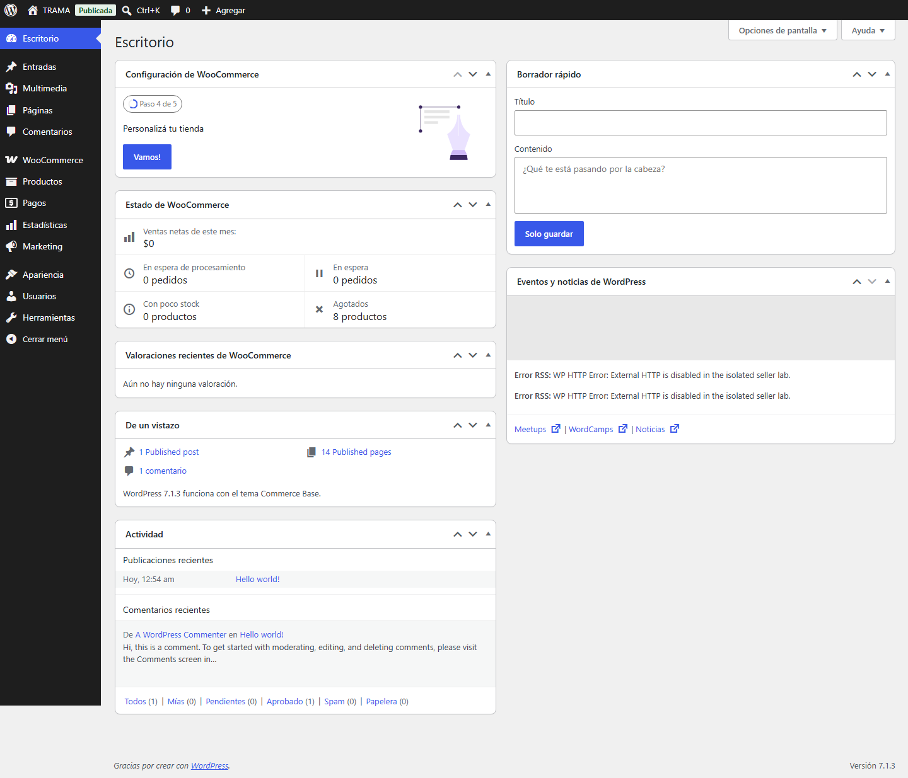
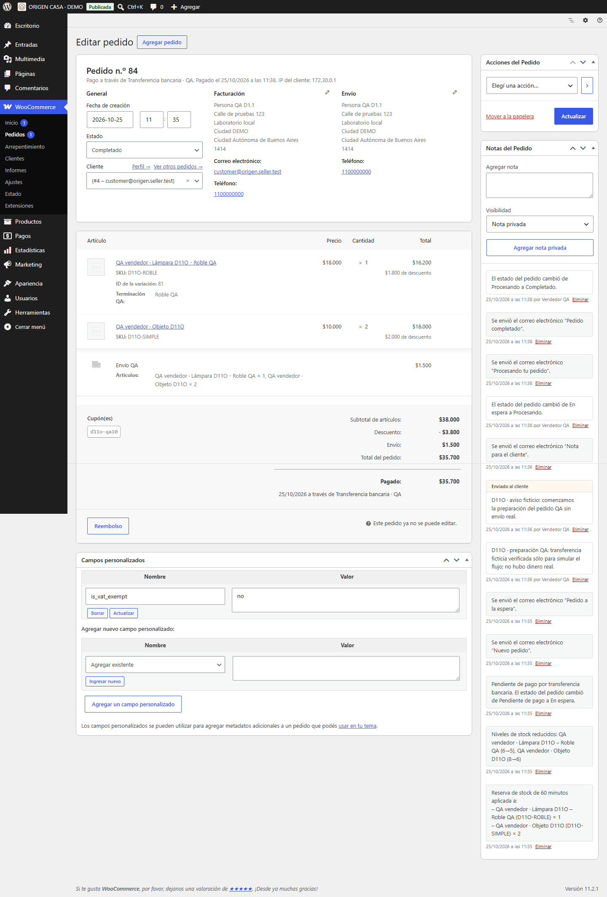
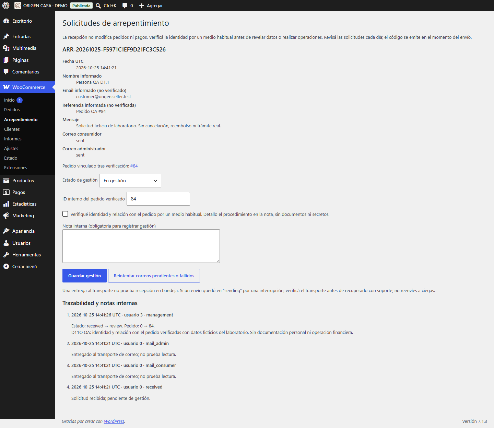

# D1.1 — Pantallas reales del vendedor

Fecha: **25/10/2026**. Las capturas corresponden a WordPress/WooCommerce locales: TRAMA vendedor `localhost:8192` y ORIGEN CASA vendedor `localhost:8193`. Son laboratorios independientes con cuentas, productos, pedidos y solicitudes ficticios. No se publicaron estas tiendas ni se habilitó el panel de las demos públicas D1.

El [resumen QA](qa-summary.json) reúne resultados y límites de la verificación; las conclusiones de usabilidad están en [la auditoría](../../d1-seller-experience-audit.md).

La etiqueta **Publicada** de la barra WordPress indica la visibilidad configurada dentro de ese laboratorio. No significa que esté desplegado en internet. Los datos de comprador, emails `.test`, teléfono y dirección que aparecen son QA; los importes tampoco son cobros o devoluciones reales. Las cuentas visibles son ficticias y no se incluyen contraseñas, cookies, nonces, claves de pedido ni exports privados.

## Recorrido recomendado

| Qué revisar | Captura |
| --- | --- |
| Menú y Escritorio del Shop Manager | [Escritorio desktop](products-role-dashboard-desktop.png) |
| Productos, precios, stock, filtros y acceso a importación/exportación | [Lista de productos](products-role-products-list.png) |
| Campos del producto simple y precio/oferta | [Editor simple](products-role-simple-editor.png) |
| Resultado del producto QA en la tienda | [Ficha publicada en el laboratorio](products-role-simple-storefront.png) |
| Producto variable de indumentaria | [Editor remera](products-role-variable-editor.png), [stock por variación](products-role-variable-stock.png), [ficha](products-role-variable-storefront.png) |
| Producto variable de decoración | [Editor jarra](products-role-decor-editor.png), [stock por Material/Capacidad](products-role-decor-stock.png), [ficha](products-role-decor-storefront.png) |
| Aviso/lista de stock bajo | [Informe nativo](products-role-low-stock-report.png) |
| Cupones con porcentaje, importe fijo y vencimiento | [15%](products-role-coupon-percent.png), [fijo](products-role-coupon-fixed_cart.png), [vencido](products-role-coupon-percent-expired.png), [lista](products-role-coupons-list.png) |
| Importador y exportador nativos de productos | [Mapeo CSV](products-role-csv-mapping.png), [alta importada](products-role-csv-imported.png), [exportación](products-role-csv-export.png) |
| Atributo global y términos de prueba | [Atributos](products-role-global-attributes.png), [Mate/Brillante](products-role-attribute-values.png) |
| Eliminación reversible del producto propio QA | [Papelera](products-role-product-trash.png) |
| Configuración nativa de zona/tarifa/gratis | [Zona CP 9999 QA](products-role-shipping-zone.png) |
| Límite móvil observado en configuración de envíos | [Envíos a 390 px con desborde horizontal](products-role-shipping-zone-390.png) |
| Retiro nativo en zona, sin afirmar prueba del retiro global Blocks | [Retiro QA](products-role-shipping-pickup.png) |
| Pedidos del vendedor | [Lista de pedidos](orders-manager-list.png) |
| Medio de pago, variantes, dirección y notas del flujo BACS, en su estado final Completado | [Detalle del pedido BACS QA](orders-manager-detail.png) |
| Estado Completado y trazabilidad | [Pedido completado](orders-manager-completed.png) |
| Reembolso parcial manual | [Formulario parcial](orders-refund-parcial-form.png) |
| Reembolso del importe restante | [Formulario del restante](orders-refund-total-restante-form.png) |
| Estado Devuelto después del registro manual | [Pedido devuelto](orders-manager-refunded.png) |
| Cancelación y reposición | [Cancelación QA](orders-cancelled-restock.png) |
| Detalle de pedido en tablet | [1024 px](orders-manager-detail-1024.png) |
| Detalle de pedido en teléfono | [390 px](orders-manager-detail-390.png) |
| Estadísticas generales | [Resumen](analytics-overview.png) |
| Importes y filtro de fechas | [Ingresos](analytics-revenue.png) |
| Informe de pedidos | [Pedidos](analytics-orders.png) |
| Productos vendidos y descarga CSV | [Productos](analytics-products.png) |
| Uso del cupón QA | [Cupones](analytics-coupons.png) |
| Clientes del laboratorio | [Clientes](analytics-customers.png) |
| Mensaje de nuevo pedido al vendedor | [Email capturado](mail-merchant-new-order.png) |
| Aviso de cancelación al vendedor | [Email capturado](mail-merchant-cancelled.png) |
| Asunto nativo de Completado frente al cuerpo de Commerce Communications | [Email capturado al comprador QA](mail-customer-completed.png) |
| Aviso de reembolso registrado, sin dinero real | [Email capturado](mail-customer-refund.png) |
| Aviso legal al responsable | [Email capturado](mail-merchant-legal.png) |
| Bandeja local de todos los eventos ficticios | [Mailpit](mailpit-workflow-list.png) |
| Solicitudes visibles al Shop Manager | [Lista legal](legal-manager-list.png) |
| Verificación, asociación, estado y nota del Shop Manager | [Detalle legal](legal-manager-detail.png) |
| Acceso del Administrator al mismo circuito | [Lista](legal-admin-list.png), [detalle](legal-admin-detail.png) |
| Páginas y editor accesibles al Shop Manager | [Páginas](personalization-manager-pages.png), [menús del Editor](personalization-manager-site-editor.png) |
| Controles de apariencia observados sin guardar cambios | [Estilos](personalization-manager-styles-controls.png), [Identity](personalization-manager-identity-controls.png) |
| Configuración general e identidad legal reservadas al Administrator | [General](personalization-admin-general-settings.png), [Identidad y legales](personalization-admin-legal-settings.png) |
| Editor de Home observado sin guardar cambios | [Home](personalization-admin-home-editor.png) |
| Listas del vendedor en tablet/móvil | [Productos tablet](personalization-manager-products-tablet.png), [móvil](personalization-manager-products-mobile.png); [pedidos tablet](personalization-manager-orders-tablet.png), [móvil](personalization-manager-orders-mobile.png) |

Las capturas de onboarding [Ingresos](analytics-revenue-onboarding.png) y [Pedidos](analytics-orders-onboarding.png) muestran avisos nativos de primer uso; las correspondientes sin ese sufijo muestran el informe después de cerrarlos. El RSS bloqueado del Escritorio y algunos recursos externos que el laboratorio intercepta no se presentan como fallos de las ventas. La evaluación de idioma, densidad y móvil se explica en [la auditoría](../../d1-seller-experience-audit.md).

En la captura Clientes se oculta únicamente el identificador privado de la cuenta QA; se conservan el nombre ficticio, email `.test` y métricas observadas. En Escritorio se oculta la región incidental del widget de eventos y los identificadores privados de sesión. Son máscaras de privacidad hechas durante la captura del navegador, sin cambiar datos ni la interfaz funcional de la tienda.

## Muestras para reconocer las pantallas

Escritorio del vendedor:

Detalle de un pedido ficticio después de completarlo; el medio BACS y la marca interna Pagado no confirman que haya dinero acreditado:

Gestión de una solicitud ficticia; guardar una gestión no modifica el pedido ni devuelve dinero:

## Evidencia de datos y permisos

| Archivo | Qué demuestra |
| --- | --- |
| [Roles originales](original-role-definitions.json) | Definiciones almacenadas sin identidades personales |
| [Historia antes](original-history-before.json), [después](original-history-after.json) | Once tablas observadas por original con huellas coincidentes; WordPress histórico sin login ni escrituras |
| [Procedencia de código](code-provenance.json) | Catorce árboles iguales entre D1 y clones; mismo theme/WooCommerce/plugins funcionales |
| [Procedencia de roles](role-provenance.json) | Coincidencia de las tres definiciones entre cada original y su clon |
| [Capacidades efectivas](products-role-capabilities.json) | Evaluación de Administrator/Shop Manager/Customer y permisos sobre usuarios objetivo |
| [Seguridad TRAMA](lab-safety-trama.json), [ORIGEN](lab-safety-origen.json) | Flag público apagado sólo en laboratorios privados; BACS ficticio, sin MP ni transporte externo |
| [Productos/roles/cupones/envíos por UI](products-role-ui.json) | Fases finales del recorrido nativo, incluida creación/variaciones/importación y denegación de pantallas por rol |
| [Persistencia de productos QA](products-role-data.json) | Veinte comprobaciones de datos guardados, complementarias del recorrido por pantalla |
| [Pedidos por UI](orders-orders.json) | Acciones nativas, estados y comprobaciones de stock |
| [Hechos finales de reembolso](orders-refund-total-restante-facts.json) | Cantidades, importes, estado Devuelto y ausencia de reservas finales |
| [Reserva temporal QA](orders-reservation-probe-facts.json) | Prueba técnica separada del recorrido UI; no una pantalla de reservas del vendedor |
| [Legal por UI](legal.json) | Gestión con ambos roles y preservación del estado del pedido |
| [Estadísticas](analytics.json) | Filtros, informes, descarga nativa y conciliación de importes sintéticos |
| [Notificaciones](mail.json) | Veinte mensajes ficticios capturados, copy y destinatarios revisados, sin transporte externo |
| [Asuntos originales](original-email-copy.json) | Lectura acotada: TRAMA tiene copy neutral; ORIGEN no tiene override; sin destinatarios ni escrituras |
| [Personalización](personalization.json) | Acceso a pantallas nativas por rol y lectura en mobile/tablet; sin guardar marca, Home ni configuración |
| [D1 público preservado](public-d1-preserved.json) | Admin/checkout/WC AJAX/Store API siguen bloqueados; catálogo/carrito disponibles en ambas demos |

Las pruebas de datos/CLI complementan la interfaz y se identifican como tales. La captura en Mailpit no acredita entregabilidad en un buzón externo. Los informes reflejan datos ficticios y configuración de fecha/estado; no son facturación, caja ni un resultado comercial real. Ver [manual del vendedor](../../d1-seller-guide.md) y [auditoría completa](../../d1-seller-experience-audit.md).

**PUBLIC DEPLOYMENT: NOT PERFORMED.**
