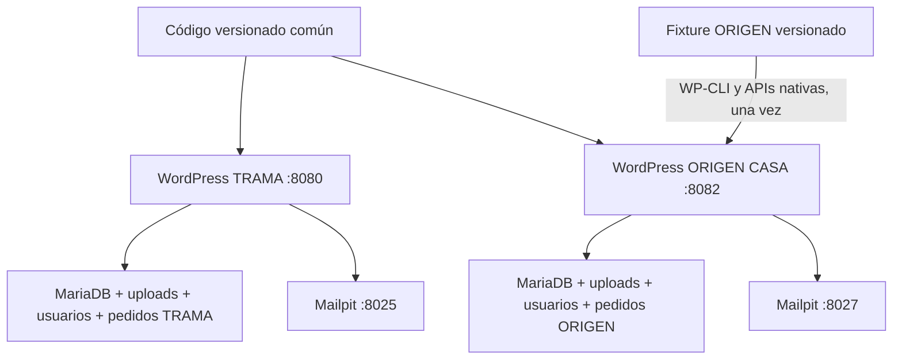

# H10 — Rebranding, portabilidad y reutilización comercial

Validación local realizada el 22/10/2026, Argentina. Este documento registra la entrega de H10; las matrices H7–H9 conservan su carácter histórico. **H10 READY como demostración técnica local. Producción NOT READY. H11 no comenzó.**

## Git y alcance

El árbol inicial estaba limpio. `git fetch origin` confirmó sincronización de la rama aprobada, con estos hashes completos:

| Hito | Commit |
| --- | --- |
| H9.1 | `5c50cc818979a9d3cdec41dfe5fbda789cf8040f` |
| H9.2 y main consolidado | `1921b3f6b176986f815a80d7e052fa3b5da388f5` |

`main` se adelantó desde `2b998dc55f0ece7757248848b9f90d89365b4131` exclusivamente mediante `merge --ff-only`; se hizo push normal a origin. Se creó `codex/h10-rebranding-portability` desde ese main. H10 no se mergea sin revisión del usuario; no hubo force push ni descartes de cambios existentes.

Primer commit H10, código común: `2adc01169c7bae44721946578158e55b67f2f94b`. El siguiente commit contiene aprovisionamiento, contenido DEMO, pruebas y documentación. Los hashes finales y sincronización se informan al entregar; consultar también `git log main..codex/h10-rebranding-portability`.

No se consultaron cuentas de hosting, DNS, dominio, SMTP o pagos comerciales. No hay despliegue público, compras de servicios ni pagos reales. Todas las operaciones de escritura QA pertenecen a las instalaciones H10.

## Arquitectura final y separación

Una base común de **Commerce Base 1.9.0**, **Commerce Core 1.1.2**, **Communications 1.0.1**, Account Navigation, Order Integrity y Lookbook atiende instalaciones WordPress independientes. No hay multisite, base compartida, segundo theme completo ni plugins duplicados por marca.



| Capa | Responsabilidad |
| --- | --- |
| Código reutilizable | Presentación, accesibilidad, atributos/stock nativos, navegación, integridad, emails y circuito legal. Se distribuye la misma revisión a ambas tiendas. |
| Configuración de cliente | Opciones WordPress/WooCommerce, `theme.json`, Global Styles/Site Editor, Custom Logo, Site Icon, menús, remitente, moneda, zonas, métodos, términos y privacidad. |
| Contenido de cliente | Páginas, Home, medios, catálogo, variantes, categorías y hotspots en la base y uploads exclusivos. |
| Fixture demostrativo | `demo/origen-casa/client.json` y `content.json`, fotografías originales y marca. Sólo los lee el importador local; el storefront no depende de ellos. |
| Datos privados | `.local/<instancia>`, secretos y volúmenes Docker excluidos de Git. No se importaron datos de TRAMA. |

Las bases utilizan el mismo nombre lógico `commerce_local` en **servidores/contenedores, redes y volúmenes distintos**; no es una base compartida. Las rutas internas de uploads y logs pueden coincidir dentro de los contenedores: sus volúmenes/espacios de ejecución son independientes. Los puertos de servicio se enlazan sólo a loopback.

## Diferencias comprobables entre las tiendas

| Área | TRAMA | ORIGEN CASA · DEMO |
| --- | --- | --- |
| Rubro | Indumentaria y accesorios originales | Decoración y hogar ficticios |
| URL | http://localhost:8080 | http://localhost:8082 |
| Mailpit | http://localhost:8025 | http://localhost:8027 |
| Proyecto/volúmenes | `demo-woocommerce-local` | `demo-woocommerce-origen-casa` |
| Identidad | Paleta verde, Newsreader, Home original | Tierra/terracota/lino, Georgia editorial, composición de ambientes y objetos |
| Catálogo | Original, incluidos fixtures técnicos históricos | Diez productos propios, ocho simples y dos variables |
| Categorías | Originales de indumentaria | Iluminación, Cerámica, Textiles, Organización |
| Atributos | Color y Talle conservados | Material, Acabado, Capacidad, Medidas; sin Talle/Color obligatorio |
| Envío | $4.500; gratis desde $100.000 | $6.200; gratis desde $150.000 después de descuentos |
| Correo | Configuración original | Remitente `hola@origen-casa.test`, colores/logo/textos propios, notificaciones `.test` |
| Mercado Pago | Estado/evidencia H7/H9 preservados | Plugin completamente inactivo; no instalado en el aprovisionamiento limpio |
| Legales | Páginas y solicitudes originales | Páginas DEMO propias; sin CUIT/QR ni datos bancarios operativos |

## Auditoría y correcciones

La [auditoría de dependencias](h10-dependency-audit.md) clasifica código, fixtures, configuración, imágenes, URLs, IDs, menús, checkout, emails, SEO y formularios. No se hicieron reemplazos globales de TRAMA.

Correcciones de código compartido:

- Filtros por los atributos nativos realmente presentes; textos de selección a partir de sus etiquetas; anticipos textuales de opciones cuando no hay Color. Los swatches de Color y la guía de talles siguen disponibles como configuración opcional.
- Paleta y tipografía del Site Editor conectadas con los tokens CSS de todo el storefront, incluidos modos claro/oscuro. TRAMA conserva sus valores por defecto.
- Textos neutrales de relacionados/estados vacíos y condiciones que enlazan a las páginas legales seleccionadas por el comercio.
- Menús opcionales de footer y opción por sitio de Exit Intent. Desactivarlo elimina diálogo y recursos; no inventa promociones. ORIGEN lo desactiva y comunica sólo el cupón real del fixture.
- Local Mail Capture respeta remitente/nombre DEMO de opciones nativas mientras el transporte continúa en el Mailpit del proyecto.
- El header permite reducir un logo ancho sin expulsar el menú fuera de pantalla; los controles mantienen sus áreas de 44 px. Communications permite partir direcciones largas en la tabla móvil del email sin cambiar plantillas oficiales.

Correcciones del proceso de instalación detectadas mediante pruebas reales: API de Global Styles inexistente, asociación explícita de `wp_theme` al ejecutar WP-CLI como usuario 0, normalización de la referencia técnica `custom_css_post_id=-1`, modo Coming Soon nativo de WooCommerce y espacio del hero bajo el acceso legal. Son correcciones del aprovisionamiento/preset; no un fork del núcleo comercial.

## Catálogo, imágenes y componentes

Lámpara Alba varía por Material/Acabado, con una combinación agotada; Jarra Río por Capacidad/Acabado. Hay ocho variaciones nativas en total, además de un producto simple agotado, ofertas, stock ficticio, pesos/dimensiones y cross-sells. WooCommerce decide combinaciones válidas, precios y disponibilidad; el theme adapta su presentación.

Home tiene hero de ambiente, cuatro categorías, colección destacada, editorial con Lookbook y tres beneficios, menú y footer propios. Los hotspots apuntan a IDs resueltos dentro de esta instalación: lámpara, jarrón y cesto del ambiente. El bloque sigue siendo opcional y reutilizable.

Las fotografías y marca fueron creadas para esta DEMO; la [procedencia, prompts y límites](../demo/origen-casa/README.md) quedan versionados. Las variaciones tienen fotografías representativas; un cliente real debe aportar fotos exactas y derechos de uso. No se copiaron imágenes comerciales sin licencia.

## Instalación repetible y recuperación

```powershell
./scripts/h10.ps1 install
./scripts/h10.ps1 inspect
./scripts/h10.ps1 verify
```

El instalador utiliza `dev.ps1`, Compose por proyecto, WordPress/WooCommerce fijados, WP-CLI y APIs nativas. Comprueba puertos al inicializar y genera contraseñas aleatorias propias. El guard rechaza TRAMA, otros hitos, hosts externos, datos comerciales previos o cuentas que no sean `.test`. No clona bases, uploads ni logs. Mercado Pago no se instala; si fue instalado manualmente se mantiene desactivado en esta DEMO.

Para una tercera DEMO con las mismas fuentes:

```powershell
./scripts/h10.ps1 install -Instance h10-repeat -WordPressPort 8083 -MailpitPort 8028
./scripts/h10.ps1 inspect -Instance h10-repeat
./scripts/h10.ps1 verify -Instance h10-repeat
```

Para una tercera **marca real**, preparar datos/contenido propios y configurar los mecanismos nativos siguiendo el [playbook](h10-new-client-playbook.md). Este fixture es explícitamente ORIGEN CASA: no es un generador universal de negocios ni debe publicarse como contenido definitivo. Una adaptación de fixture/importador no requiere editar Commerce Base o Commerce Core.

`seed` terminado calcula/verifica huellas y no vuelve a escribir objetos. Si detecta ediciones en contenido, opciones, fuentes, medios, navegación o stock, se niega a sobrescribirlas. Una venta legítima que descuenta stock también provoca esa negativa: **no es un error de la tienda ni una orden de restaurar el fixture**. `verify` es un verificador del baseline del fixture, no un monitor de salud posterior a ventas. Para revisar un entorno que ya operó usar el QA funcional y `inspect`, explicando las diferencias esperadas.

Las fases `preparing`, `imported` y `complete` hacen visibles interrupciones. No se promete atomicidad: hooks/DDL y archivos pueden persistir pese al rollback SQL. Se probaron una recuperación temprana estricta y un fallo previo a escritura por imagen faltante. Los casos fuera de esas guardas necesitan inspección/reparación deliberada o recreación de la instancia descartable. Los procedimientos y resultados se detallan en [recuperación](evidence/h10/fixture-recovery-review.md).

Cambiar URLs de otra instalación requiere backup propio y `wp search-replace` con `--dry-run`, soporte de serializados y exclusión de `guid`, conforme a la [referencia oficial](https://developer.wordpress.org/cli/commands/search-replace/). H10 no necesitó migrar contenido de TRAMA ni reemplazar un dump SQL.

## Pruebas y evidencia

La evidencia final se conserva en `docs/evidence/h10/`; los tokens, contraseñas, respuestas con claves de pedido y manifiestos privados permanecen en `.local/`. No se publican filas de clientes, pedidos o solicitudes de TRAMA ni huellas individuales de sus emails.

| Área | Resultado/evidencia |
| --- | --- |
| TRAMA visual | [shared-runtime.json](evidence/h10/shared-runtime.json): ocho combinaciones ancho/modo, Home idéntica píxel por píxel antes/después. [browser-trama.json](evidence/h10/browser-trama.json): 88 vistas, 600 checks. |
| Preservación inicial | [trama-before.json](evidence/h10/trama-before.json) y [trama-during-setup.json](evidence/h10/trama-during-setup.json): tablas comerciales, usuarios, configuración y uploads idénticos. |
| Importación y repetición | [origen-initial.json](evidence/h10/origen-initial.json), [origen-repeated.json](evidence/h10/origen-repeated.json). |
| Recuperación real | [recovery-early.json](evidence/h10/recovery-early.json), [style-repair.json](evidence/h10/style-repair.json). |
| Navegador completo | [browser.json](evidence/h10/browser.json): **184 vistas completas + 16 casos focales de header; 1545 checks; 32 casos axe sin violaciones; 48 capturas**. 390/768/1366/1920 px y ambos modos. |
| Marca y atributos | [origen-style-runtime.json](evidence/h10/origen-style-runtime.json): paleta/Georgia, menú visible, hero separado del acceso legal, filtro Material real, ambas variables, opción agotada y hotspots locales. |
| Carrito/checkout/BACS | [checkout.json](evidence/h10/checkout.json): 14 controles; variación Material/Acabado y simple, cupón, envío $6.200, botón nativo de pedido, confirmación y clave incorrecta rechazada. **Pedido ficticio #74 en espera**, de cliente propio, sin dinero real. |
| Segundo variable/envíos | [variants-shipping.json](evidence/h10/variants-shipping.json): ocho controles; Capacidad/Acabado, mini-cart, envío gratis desde $150.000 y pérdida/recuperación del beneficio al aplicar/quitar descuento; agotado rechazado. |
| Cuentas y legales | [account-legal.json](evidence/h10/account-legal.json): 37 controles, registro público, recuperación por Mailpit, pedido propio, dirección persistida, invitado sin JS/referencia/motivo, constancia, permisos, nonce y gestión review con enlace HPOS. |
| Emails | [emails.json](evidence/h10/emails.json): par nativo admin/cliente BACS más una repetición del mismo recibo para QA de reflow, todos capturados localmente. Identidad, multipart, enlaces propios, `.test`, estado pendiente y constancia legal correctos. [email-wrapping.json](evidence/h10/email-wrapping.json): render nativo a 390/900 sin overflow tras la corrección compartida. |
| Funcional backend | [functional.json](evidence/h10/functional.json): 16 controles aprobados, diez productos/dos variables, HPOS, pedido del cliente y módulo legal. |
| SEO y privacidad | [metadata.json](evidence/h10/metadata.json): seis rutas con marca/URL/favicon/OG/JSON-LD propios, noindex, robots y sitemap privado. |
| Infraestructura | [infrastructure.json](evidence/h10/infrastructure.json): tres proyectos con redes, DB/WordPress/Mailpit y volúmenes distintos; credenciales independientes. |
| Aislamiento concreto | [isolation-mutations.json](evidence/h10/isolation-mutations.json): precio, Home y privacidad realmente editados en ORIGEN, seed rechazó sobrescribir; TRAMA íntegra; tres valores restaurados. [isolation-final.json](evidence/h10/isolation-final.json): todas las tablas/config/uploads originales intactos, clientes disjuntos, salts distintos y código común idéntico. |
| Tercera tienda/repetición | [third-install-preflight.json](evidence/h10/third-install-preflight.json), [third-install-repeat.json](evidence/h10/third-install-repeat.json), [third-final-verify.json](evidence/h10/third-final-verify.json): fallo por imagen ausente antes de escribir, recuperación, instalador completo repetido sin IDs/credenciales duplicados o regenerados y diez invariantes aprobadas. |

La captura de TRAMA antes/después tiene diferencia **0 píxeles**. Las huellas finales conservan sus 444 posts, 3082 metas, 10 usuarios, 235 pedidos HPOS, 59 solicitudes legales y 342 archivos de uploads; esos números incluyen pruebas históricas y no representan ventas/clientes reales. En ORIGEN se conservaron sólo los cambios legítimos de stock del pedido: reimportar el fixture se rechaza por esos dos productos, con Home y privacidad restituidos byte a byte en su contenido.

La corrección de email se verificó reenviando la constancia del mismo pedido por su disparador WooCommerce, sin modificar estado/stock. Los mensajes anteriores permanecen en Mailpit como evidencia histórica. Una alerta administrativa nativa de activación de BACS se emitió durante el aprovisionamiento antes de configurar el remitente; fue `.test`/Mailpit y se informa separada de los emails transaccionales finales. No hubo correo real ni SMTP productivo.

Capturas principales: [TRAMA desktop](evidence/h10/trama-after-1366-light.png), [ORIGEN desktop](evidence/h10/origen-after-1366-light.png), [ORIGEN mobile dark](evidence/h10/origen-after-390-dark.png), [ficha](evidence/h10/origen-variable-390-dark.png), [checkout](evidence/h10/origen-checkout-390-dark.png), [email](evidence/h10/origen-email-bacs-390.png) y [constancia](evidence/h10/origen-withdrawal-receipt.png).

Las matrices visuales revisan 390/768/1366/1920 px, ambos modos, Home, catálogo, categorías, fichas, agotado, carrito, checkout, cuenta y legales. Se evalúan teclado/foco, menú, mini-cart, selectores nativos y no-JS. Se inventarían solicitudes externas y se bloquean en QA: el emoji de zoom de la galería de WooCommerce depende del CDN de WordPress y su bloqueo no equivale a una imagen de producto ausente. No se certifica WCAG AA, lectores de pantalla, dispositivos físicos ni Core Web Vitals de producción.

## Requisitos pendientes y entrega a un cliente

El cliente aporta identidad/derechos, catálogo/fotos, precios/stock/impuestos, cobertura y condiciones, datos legales/fiscales auténticos y acceso autorizado a proveedores. El implementador prepara una instalación aislada, adapta configuración/contenido, prueba el circuito y registra la entrega. El [playbook](h10-new-client-playbook.md) y [checklist reutilizable](h10-delivery-checklist.md) detallan tareas, responsables y mantenimiento, sin inventar precios o planes.

Se mantienen los [bloqueos de H9](h9-production-readiness.md): autenticidad/replay/temporalidad e importe/moneda/asociación de Mercado Pago; soporte y tratamiento de recursos externos; HTTPS/dominio/proxy; correo real y autenticación DNS; identidad/legales/fiscalidad; backups/restauración offsite; permisos, cache, cron y monitoreo del hosting real. BACS sigue siendo ficticio y pendiente de datos/conciliación de un comercio real.

Docker Desktop estaba detenido y falló al arrancar por sockets AF_UNIX dañados. Se recuperó conservando los directorios de sockets con sufijo `.h10-stale-20261022-213920` y respaldando `settings-store.json`; se desactivó `EnableDockerAI` para evitar el fallo de inicialización. No se resetearon imágenes/bases/volúmenes ni se desregistró WSL. Este cambio de herramienta local es reversible con sus respaldos; no forma parte del código comercial. La incidencia coincide con el [reporte del repositorio oficial Docker](https://github.com/docker/desktop-feedback/issues/531).

Archivos principales: `commerce-base/` (tokens, atributos, componentes, preset y templates); `commerce-communications/` (reflow de email); `docker/local-mail.php`; `compose.h10.yaml`; `scripts/h10.ps1`; `docker/tools/h10-{guard,store,state,qa}.php`; `demo/origen-casa/`; `tests/verify-h10-*.cjs`; este informe, auditoría, playbook, checklist y evidencia. Los commits separan código reutilizable de aprovisionamiento/contenido/QA/documentación; la lista exacta se obtiene con `git diff --name-only main...codex/h10-rebranding-portability`.

La base está preparada para tiendas de clientes diferentes mediante configuración y contenido independientes, conservando la arquitectura común. La aprobación técnica H10 no reemplaza los datos, verificaciones y autorización de publicación del cliente. La rama se entrega para revisión y permanece fuera de main. Al cierre, TRAMA y ORIGEN CASA quedan funcionando simultáneamente; la tercera instalación de prueba se detuvo conservando sus volúmenes/secretos. El inventario de archivos y checks de entrega está en [files.json](evidence/h10/files.json).

H11 queda limitado a una lista de requisitos. No se empezó su implementación, no se publicó la DEMO, no se modificó DNS ni se contrataron servicios. H10 no declara Mercado Pago listo para producción.
