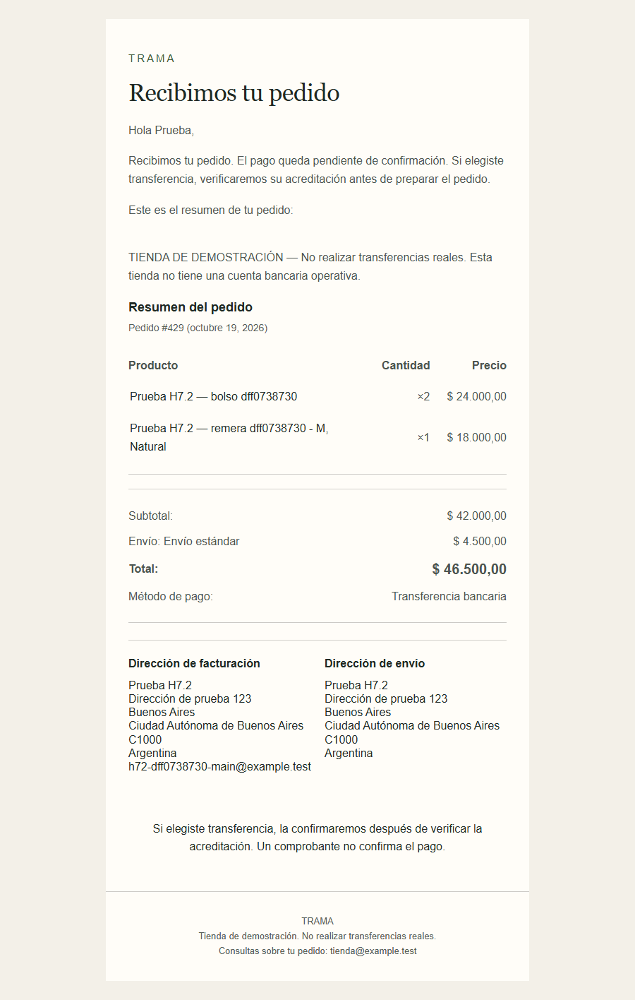

# H7.2 — Comunicaciones y operación de pedidos

Implementación local del 19/10/2026, Argentina, en `C:\Codigo\demo-woocommerce`. Entrega para revisión visual del usuario; **no mergear H7.2 a main**. H8 no se inició.

**Cierre del 20/10/2026:** el usuario aprobó H7.2 y las correcciones posteriores de Mi Cuenta. Se verificó origin y working tree limpio, se repitió la regresión (cuenta 25/25, configuración 14/14, navegación 11/11, integridad 31/31) y se consolidaron `9c86053` y `7e09c7c0e4a8206df00acbb6a22a53d85a0fdfa8` mediante fast-forward y push normal. `main = origin/main = 7e09c7c0e4a8206df00acbb6a22a53d85a0fdfa8`. Las menciones anteriores/posteriores a revisión pendiente describen el momento de entrega original. Continúa en [H8.1](h8-1-commerce-core.md), sin H8.2 ni cambios en los bloqueos productivos de Mercado Pago.

## Cierre previo de H7.1

Se verificaron branch, remote, working tree limpio, historial y los cinco documentos H7.1 antes de editar. `686006c736f283c9ea013815b43e382d6a8fc922` coincidía con `origin/codex/h7-1-payments`. El cierre documental agregó **`64d57a4acaa66e5336d3738c8a9a6427a7aa197c`**; los cuatro commits H7.1 se integraron por fast-forward desde `c736cdc50d57821eca27a56867a069914c962659`. Push de main exitoso, main/origin/main idénticos. H7.2 se creó desde ese main en **`codex/h7-2-communications-operations`**. Sin force push ni descarte de commits.

Regresión previa: 33/33 funcionales H7.1, 7/7 guardas, 31/31 concurrencia Store API/hidratación/Blocks, 21/21 envíos/cupones H6.2 y 6/6 flujos Chromium H5/H6. No se repitieron pagos externos. Commerce Order Integrity 1.0.0 sigue activo, versionado, independiente del theme, montado RO en wordpress/wpcli y sin cambios de código. Reintentos y `order-pay` conservan sus permisos nativos.

**Mercado Pago sigue bloqueado para producción:** HMAC ausente en receptor efectivo, replay externo idéntico original no comprobado, eventos tardíos/orden temporal insuficientemente garantizados, timestamp diagnóstico cambiante, posible `cancelled` → `pending` con recurso obsoleto simulado, comprobaciones independientes insuficientes de importe/moneda/asociación pago-pedido y certificación productiva MP 8.9.6/WC 11.2.1 pendiente. [Auditoría completa](h7-concurrency-audit.md). Pro permanece deshabilitado; plugin oficial instalado/activo e intacto. No se agregó receptor ni solución HMAC propia.

## Arquitectura

WooCommerce **11.2.1**, WordPress **7.1.3**, PHP **8.4.26**, ARS, `es_AR`, HPOS y Cart/Checkout Blocks. WooCommerce sigue siendo la fuente de verdad: CRUD de pedidos, notas, estados, reembolsos y stock. El correo recorre `WC_Email → wp_mail → PHPMailer → Mailpit` local. No hay tablas adicionales, motor de notificaciones, cola o deduplicación propios.

La extensión acotada [Commerce Communications](../commerce-communications/commerce-communications.php) contiene exclusivamente presentación reutilizable:

- `woocommerce_email_styles`: jerarquía editorial, tipografías seguras y tamaño móvil legible. WooCommerce aplica Emogrifier e inline CSS sobre sus tablas HTML.
- `woocommerce_email_order_items_args`: omite miniaturas de productos para no depender de SVG de placeholders, imágenes externas ni su carga en el cliente. Logo opcional sigue siendo configuración nativa; demo usa nombre textual.
- `gettext_woocommerce`: reemplaza unas pocas frases exactas de emails en español; conserva placeholders y usa el mismo copy en HTML/plain. Filtro `commerce_communications_email_copy` disponible para adaptar ese vocabulario. No intercepta otros dominios ni cambia estados.
- `woocommerce_view_order`: muestra el renderer BACS nativo en la vista autorizada, sólo `bacs + on-hold`; repite `current_user_can('view_order', id)`. No añade endpoints ni expone invitados/órdenes ajenas.

No se copiaron templates ni se modificó WooCommerce, Mercado Pago o Commerce Order Integrity. Los templates upstream conservan su versión: principales HTML de estados `10.4.0`, on-hold plain `9.8.0`, según 11.2.1 instalado. Si cambia WooCommerce, revisar frases exactas, hooks y estilos y repetir QA. No hay overrides que sincronizar.

`email_improvements` ya estaba activo y es estable. `block_email_editor` es **alpha** y continúa apagado; también permanecen apagados emails diferidos, reviews, fulfillments y withdrawal. No hay plugin visual de email ni Commerce Core.

## Inventario efectivo de emails

Se inspeccionaron las clases instaladas y `WC()->mailer()->get_emails()` **antes** de configurar. Evidencia privada: `.local/local/h7-2/before-configuration.json`; inventario final `verify.json`. Todos los siguientes usan **multipart: HTML + texto plano**. Los destinatarios de comprador son `billing_email`; no exigen cuenta.

| ID nativo | Habilitado final | Evento real en 11.2.1 | Destinatario |
| --- | --- | --- | --- |
| `new_order` | Sí | pending/failed/cancelled → on-hold/processing/completed; core evita repetir el primer aviso automático | `operaciones@example.test` |
| `cancelled_order` | Sí | pending/on-hold/processing → cancelled | Administrador configurado |
| `failed_order` | Sí | pending/on-hold → failed | Administrador configurado |
| `customer_cancelled_order` | Sí; antes No | on-hold/processing → cancelled; **no pending → cancelled** | Comprador |
| `customer_failed_order` | Sí | Entrada a failed | Comprador |
| `customer_on_hold_order` | Sí | pending/failed/cancelled → on-hold | Comprador |
| `customer_processing_order` | Sí | pending/failed/cancelled/on-hold → processing | Comprador |
| `customer_completed_order` | Sí | Entrada a completed | Comprador |
| `customer_refunded_order` | Sí | `woocommerce_order_fully_refunded` / `woocommerce_order_partially_refunded` | Comprador |
| `customer_invoice` | Manual; flag enabled No | Acción explícita “Enviar detalles del pedido al cliente”; su envío manual nativo no depende de ese flag | Comprador |
| `customer_note` | Sí | Nota marcada para cliente, no nota interna | Comprador |
| `customer_new_account` | Sí | Creación nativa de cliente | Email de cuenta |
| `customer_reset_password` | Sí | Solicitud nativa de restablecimiento | Email de cuenta |
| `customer_verify_email` | Sí | Solicitud del flujo nativo de verificación, con rate limit/permisos del core | Email de cuenta |

La clase de refund utiliza temporalmente ID `customer_partially_refunded_order` al emitir un parcial; no se crea otra notificación. Los campos de asunto/encabezado son `subject_partial/full`, `heading_partial/full`. Admin `failed_order` no escucha processing → failed, aunque la descripción de su UI puede sugerirlo. No se infiere un evento por su nombre.

También está registrado `admin_payment_gateway_enabled`, HTML habilitado a `owner@example.test`; no se cambia ni se dispara una activación de pasarela para probarlo. `customer_pos_completed_order` y `customer_pos_refunded_order` son manuales y permanecen deshabilitados, HTML. No se activan funciones fuera de alcance.

Fuentes primarias: [registro oficial de emails 11.2.1](https://raw.githubusercontent.com/woocommerce/woocommerce/11.2.1/plugins/woocommerce/includes/class-wc-emails.php), [cancelación al comprador](https://raw.githubusercontent.com/woocommerce/woocommerce/11.2.1/plugins/woocommerce/includes/emails/class-wc-email-customer-cancelled-order.php), [API nativa de email](https://raw.githubusercontent.com/woocommerce/woocommerce/11.2.1/plugins/woocommerce/includes/emails/class-wc-email.php). Se contrastaron con el código runtime, sin instalar actualizaciones.

## Identidad, copy y configuración

El nombre textual **TRAMA** deriva del título de WordPress; el plugin no lo fija. `woocommerce_email_from_name` conserva el fallback nativo al nombre del sitio. Editar una identidad nueva desde Ajustes generales y WooCommerce → Ajustes → Correos electrónicos.

| Token de Commerce Base | Opción nativa / valor demo |
| --- | --- |
| Acento | base `#405b35` |
| Fondo | background `#f3f0e8` |
| Superficie email | body background `#fffdf8` |
| Texto | `#202a24` |
| Texto secundario | footer `#586157` |

El mapping es deliberadamente sencillo y explícito; no intenta resolver variables CSS/dark mode del sitio dentro de un email. Los colores se editan en WooCommerce. Encabezados Georgia/Times New Roman; cuerpo Arial/Helvetica/sans-serif. Ancho máximo 600px, texto 16px también en móvil, tablas semánticas nativas y links subrayados. No hay fuentes remotas, JavaScript, animaciones ni Tailwind.

Remitente demo `tienda@example.test`; Reply-To del comprador `soporte@example.test`. En avisos admin new/cancelled/failed, WooCommerce conserva Reply-To al comprador. No se fuerza globalmente otra respuesta. Estas direcciones no son operativas y sólo se usan en Mailpit. Footer con `{site_title}` y `{store_email}`, advertencia demo y saltos de línea que preservan HTML/plain. No incluye dirección/propietario/telefonía fijos.

Asuntos y encabezados se guardan en los ajustes de cada email, con `{site_title}` y `{order_number}`. Processing comunica pedido confirmado y pendiente de preparación; Completed informa finalización de gestión, sin “en camino”, entrega física o plazo inventado. Refund comunica **registro**; cancelación aclara que no devuelve dinero automáticamente. “Detalles del pedido” no es factura fiscal.

[Fixture demo](../demo/communications/emails.json) y [migrador local](../docker/tools/h7-2-communications.php) están separados del plugin comercial. `configure` exige backup íntegro y localhost local, comprueba destinatarios ficticios al aplicar por primera vez y preserva pagos/datos bancarios. Repetirlo es idempotente. Si hubo edición manual posterior, se detiene sin sobrescribirla. Una actualización explícita del fixture sólo migra si coincide la última configuración aplicada; se verifica también `fixture_hash`. Nunca ejecutarlo como configuración de un cliente real.

## BACS y operación administrativa

La descripción del checkout y las instrucciones siguen siendo **las de H7.1**, sin alterar sus guardas ni datos bancarios: “TIENDA DE DEMOSTRACIÓN — No realizar transferencias reales. Esta tienda no tiene una cuenta bancaria operativa.” Lista de cuentas vacía; no hay CBU/CVU/alias/titular real ni ficticio operativo.

1. El comprador completa Checkout Blocks con BACS. WooCommerce crea el pedido `on-hold`, sin fecha de pago ni transacción; reduce stock una vez.
2. Se envían `new_order` al comercio y `customer_on_hold_order` al comprador. “Recibimos tu pedido” y “pendiente de confirmación” no afirman recepción de dinero. El renderer BACS agrega las mismas instrucciones de ajustes.
3. Order Received conserva el texto de H7.1 pendiente de verificación. Mi Cuenta muestra estado y detalle nativos; en espera muestra instrucciones BACS del mismo gateway. No se muestran para otro medio ni después de processing.
4. En una tienda real, el comerciante verifica **acreditación en su banco**, importe y pedido. Una captura del comprador no es suficiente. En QA esto es simulado y queda nota explícita.
5. En WooCommerce → Pedidos → editar pedido, cambiar a **Procesando** y guardar. Para físicos significa pago confirmado y preparación pendiente; el core registra fecha de pago y envía `customer_processing_order`. No reduce otra vez. No existe botón propio de “confirmar pago”.
6. Cambiar a **Completado** al finalizar la gestión comercial. Se envía `customer_completed_order` y se actualiza Mi Cuenta. No hay tracking ni integración logística.

En el panel nativo se puede reenviar “Detalles del pedido al cliente” o “Notificación de nuevo pedido”. Un reenvío explícito es válido; no cambiar repetidamente de estado para forzarlo. Notas internas no envían correo al comprador; “Nota al cliente” sí envía `customer_note`. Guardar/recargar con el mismo estado no crea una transición ni un correo propio adicional.

## Cancelaciones y reembolsos manuales

Para un impago, cancelar desde el pedido nativo, añadir una nota clara y revisar la reposición. Pending → cancelled avisa al administrador; on-hold/processing → cancelled avisa también al comprador ahora que el email nativo está habilitado. No se inventa un correo para los otros caminos. Una cancelación de pedido previamente confirmado **no genera refund ni devuelve dinero**: coordinarlo por separado.

Procedimiento manual de QA: abrir un pedido **nuevo y sintético**, pulsar **Reembolso**, indicar cantidades e importes por línea, revisar impuestos/envío y decidir “Reponer artículos reembolsados”. Introducir razón y usar **Reembolso manual**. No usar una acción de devolución por pasarela. El registro corresponde a `wc_create_refund(..., refund_payment=false)` y `get_refunded_payment()=false`.

- Parcial: crea `WC_Order_Refund` con cantidades/importes negativos en sus líneas, conserva processing en el caso probado y envía email parcial. Puede reponer sólo las cantidades elegidas.
- Total: completar el saldo mediante otro registro, incluyendo envío si corresponde. El procedimiento nativo establece refunded al alcanzar el total y emite email total. No marcar estado refunded como sustituto del registro.
- Sin reposición: un reembolso total puede dejar stock reducido. El estado refunded por sí solo no repone inventario.

Después de una reposición por refund, el flag global `stock_reduced` puede seguir true: comprobar también cantidades reembolsadas, `_reduced_stock` por línea y stock físico. No interpretar ese flag aislado como unidades faltantes. En texto plano, core puede unir monto y razón al quitar HTML; las razones sintéticas comienzan con un separador legible. No se modifica el proveedor ni se normalizan importes para esconder diferencias.

En estos tests no hay dinero acreditado ni devuelto. Las líneas de impuesto son cero porque las fixtures son no gravadas; no se modificaron reglas fiscales y no se certifican cálculos tributarios de un cliente. Se probó devolución del envío. Con impuestos reales habrá que revisar sus líneas en el entorno comercial correspondiente.

## Stock observado en 11.2.1

| Paso probado | Resultado nativo |
| --- | --- |
| BACS → on-hold | Reduce una vez aunque el dinero esté pendiente |
| on-hold → processing → completed | No vuelve a reducir |
| Guardar de nuevo el mismo estado / notas / reenvío | Sin cambios físicos |
| pending → cancelled/failed sin reducción previa | Sin reposición inventada |
| on-hold → cancelled/failed | Repone lo previamente reducido, una vez |
| processing → cancelled | Repone según banderas nativas; no crea reembolso monetario |
| Parcial con cantidades + restock | Repone sólo las cantidades indicadas; conserva resto reducido |
| Total con restock | Repone las cantidades restantes elegidas |
| Total sin restock | Estado refunded, sin reposición |

Las banderas del data store y `_reduced_stock` por línea controlan los efectos; no se añaden hooks de inventario. Se midieron valores físicos antes/después y preservación de todo el catálogo previo. [Stock oficial](https://raw.githubusercontent.com/woocommerce/woocommerce/11.2.1/plugins/woocommerce/includes/wc-stock-functions.php), [refund oficial](https://raw.githubusercontent.com/woocommerce/woocommerce/11.2.1/plugins/woocommerce/includes/wc-order-functions.php).

## Mailpit, seguridad y reproducibilidad

[Mailpit](http://localhost:8025/) conserva históricos y captura SMTP interno `mailpit:1025`; no se configuró SMTP real. No se borró su bandeja. Los nuevos pedidos/correos usan destinatarios `example.test`, nombres ficticios y marcas propias por corrida. QA bloquea HTTP externo, valida Mailpit y rechaza envíos ajenos al run o a dominios de prueba. Los headers `X-Commerce-QA-*` existen sólo durante el comando QA, no en el plugin persistente.

Backup previo completo: `.local/local/backups/h7-2-before-communications-20261019`. Al iniciar hubo un error de sockets temporales de Docker Desktop. Se conservaron por rename acotado fuera del repo y se regeneraron, sin reset/prune, actualización o movimiento de volúmenes. Se recuperó el motor existente y la tienda. No hay dependencia del plugin comercial en esa reparación.

Para reproducir en la principal existente, después de completar H1/H2 y los hitos previos:

```powershell
.\scripts\dev.ps1 backup -BackupId h7-2-antes-de-la-sesion
.\scripts\dev.ps1 start
.\scripts\dev.ps1 wp -WpArgs @('plugin','activate','commerce-order-integrity','commerce-communications')
.\scripts\h7-2.ps1 inspect
.\scripts\h7-2.ps1 configure -BackupId h7-2-antes-de-la-sesion
.\scripts\h7-2.ps1 verify
.\tests\verify-h7-2.ps1
# Con el runtime Node y NODE_PATH de esta máquina:
node tests/verify-h7-2-email-layout.cjs
node tests/verify-h7-2-browser.cjs
```

Los plugins se montan versionados RO en ambos servicios. Activarlos explícitamente en una instalación nueva; `start` conserva plugins/configuración existentes y no resetea contenido. El configurador sólo modifica ajustes de emails demo, no bank data, usuarios históricos, MP ni pedidos. Para otro comercio se configura WooCommerce directamente y se distribuye la extensión; no se transporta el fixture demo, DB, `.local`, backups, pedidos QA o Mailpit.

Pedidos de invitado conservan claves y verificación de correo nativas. Mi Cuenta exige login y propiedad. No se crean URLs públicas de consulta, ni se imprimen claves en reportes sanitizados o Git. Emails de cuenta conservan sus enlaces seguros nativos y no contienen contraseñas en texto plano. No hay tokens, secretos, metadatos MP o tarjetas en el contenido. Los HTML/raw y enlaces privados de prueba quedan ignorados en `.local/`.

## QA, evidencia y revisión visual

La matriz funcional cubre BACS, admin/comprador, processing, completed, cancelaciones desde pending/on-hold/processing, failed desde pending/on-hold, parcial/total con reposición y total sin reposición, notas internas/públicas, guardado repetido y dos reenvíos explícitos. Cada corrida crea productos/pedidos propios; nunca repara, cancela o borra históricos para reutilizarlos. Se comparan hashes privados de pedidos y catálogo preexistentes, preservando #275–280, #296, #331–337 y los demás.

Evidencia privada bajo `.local/local/h7-2/`: `functional-report.json`, `mailpit-report.json`, `review-links.json`, `email-layout-report.json`, `mail/<run>/` y `previews/`. El reporte Mailpit vincula cada mensaje a su ID/email/evento/pedido y conserva HTML/plain, destinatario, asunto, importe, envío, variantes y cantidades. El reporte de navegador conserva rutas privadas y capturas propias.

| Verificación | Resultado final |
| --- | --- |
| Configuración H7.2 | 14/14: HPOS, plugins, Blocks, configuración/fixture vigente, BACS y Pro apagado |
| Operación nativa y stock | **133/133**, 8 pedidos nuevos en última corrida |
| Mailpit | **615/615**, 33/33 mensajes reales locales, destinatario/From/Reply-To/asunto/HTML/plain/cantidades/variantes/envío/importes/copy/ausencia de secretos |
| Layout y contraste | **147/147**: 12 tipos × 3 motores × 4 anchos + 3 contrastes. Chromium/Firefox/WebKit a 320/390/600/900px; 24 previews finales |
| Browser BACS, permisos, cuenta, wp-admin | **13/13**, 0 errores JS funcionales y 0 assets fallidos |
| Bienvenida y solicitud de restablecimiento | **2/2** HTML/plain en español; sin enviar la contraseña ni seguir el enlace de reset |
| Correlación de emails del checkout browser | **1/1**, datos/variantes/cupón/envío/cantidades coherentes |
| Regresión core posterior H7.1 / H6.2 | **33/33 + 21/21**, sin nuevas transacciones externas |
| Concurrencia COI | **31/31** en cierre previo; activo/verificado y mismo código al finalizar H7.2, además de refresh/guardados/permisos en browser |
| Smoke posterior Home/H5/H6 | **7/7 Chromium**: Home/lookbook, catálogo, ficha simple/variable/agotada, carrito/mini-cart/cross-sells/Exit Intent, checkout, cupón y envíos; 0 errores JS/assets y 0 POST finales. Reporte `h6-2/browser/h7-2-regression.json` |

Última matriz: run `dff07387303a4f3b935f0f51eb8c013a`, pedidos **#429–435 y #438**. Se preservaron exactamente los **163 pedidos y 119 objetos de catálogo previos** al comenzar esa corrida. Stock propio simple 100→97 y variación 100→99: dos unidades simples + una variable del pedido completado y una simple del refund sin reposición. Parcial de #435: $12.000 y una unidad; saldo total: $34.500, incluye envío $4.500 y resto de unidades. Dos registros suman $46.500; ambos `refunded_payment=false`. #438 refund total $16.500 sin restock. Ningún ajuste directo de inventario.

Browser real conserva **#424 invitado/en espera**, simple+variación M/Natural, cupón 10%, subtotal $30.000, descuento $3.000, envío $4.500 y total **$31.500**; **#425 cuenta/completado**, total $16.500. Los estados de #425 se operaron en wp-admin nativo; Mi Cuenta se revisó en espera/procesando/completado a 390/1366px. El pedido ajeno y una clave inválida ocultaron datos. Stock de esos productos propios 20→18 simple y 20→19 variación; recarga y guardados repetidos no lo duplicaron. Cero borradores propios restantes, cupón retirado y carritos propios vacíos; pedidos conservados.

Los primeros diagnósticos no se ocultan: el runner browser inicialmente completó provincia antes de país y el core limpió los campos; se corrigió el test antes de enviar checkout y se retomaron las mismas fixtures. El primer layout de refund a 320px desbordó 28px; se corrigió CSS de celdas y apilado de direcciones, sin ocultar overflow ni bajar texto de 16px. Se verificó prototipo sin enviar correos y después se capturó otra matriz nativa completa. Las corridas propias anteriores se conservan. Un chequeo de layout inicialmente rechazó el enlace HTTPS oficial que WooCommerce incluye en el aviso admin de nueva orden; se limitó la excepción a esa ayuda administrativa oficial, sin admitir hosts arbitrarios en links de pedido.

Telemetría externa de Mercado Pago se bloqueó deliberadamente en los tests de navegador; sus errores esperados están separados de errores funcionales. Cero errores PHP críticos observados. Sintaxis PHP/PS/Node, whitespace y barrido de secretos revisados. Cero pagos reales, reembolsos monetarios, SMTP real o destinatarios reales no autorizados.

Capturas seleccionadas versionadas en [índice de evidencia](evidence/h7-2/README.md), sólo PNG con datos sintéticos; HTML/raw/claves y enlaces de cuenta permanecen privados. Las imágenes de emails son snapshots del momento del evento; el pedido puede haber avanzado de estado después.



## Revisión manual y límites

- [Home](http://localhost:8080/), [catálogo](http://localhost:8080/?post_type=product), [carrito](http://localhost:8080/?page_id=8), [checkout](http://localhost:8080/?page_id=9).
- [Pedidos HPOS](http://localhost:8080/wp-admin/admin.php?page=wc-orders), [emails y remitente](http://localhost:8080/wp-admin/admin.php?page=wc-settings&tab=email), [BACS](http://localhost:8080/wp-admin/admin.php?page=wc-settings&tab=checkout&section=bacs).
- [Mi Cuenta](http://localhost:8080/?page_id=10); la cuenta QA usa credenciales guardadas sólo en `.local/local/h7-2/browser/fixture-private.json`. No copiar ese archivo a Git.
- [Pedido invitado #424 en administración](http://localhost:8080/wp-admin/admin.php?page=wc-orders&action=edit&id=424), [pedido de cuenta #425](http://localhost:8080/wp-admin/admin.php?page=wc-orders&action=edit&id=425), [reembolso #435](http://localhost:8080/wp-admin/admin.php?page=wc-orders&action=edit&id=435).
- [Mailpit BACS final](http://localhost:8025/view/1VB9v5ILmR15Tl6XLRrZL4), [aviso admin](http://localhost:8025/view/2HWRYqlC3eK23dt19ehIgV), [Processing](http://localhost:8025/view/5cR6Mw7teZM70LByjblpWA), [Completed](http://localhost:8025/view/4kEkALc9n9nQjDm6PzuTXF).
- [Cancelado comprador](http://localhost:8025/view/4olID1TzCPywTndeZCzRUg), [fallido comprador](http://localhost:8025/view/6S0AdKEtHtXnVPo5JxM2tq), [refund parcial](http://localhost:8025/view/1BHvWoXebxpzNUuy7egnND), [refund total](http://localhost:8025/view/36BwJUYYmef9tclSE48kRR).
- [Cuenta nueva](http://localhost:8025/view/6vG4wmeGLGH2mXUcUenMjZ), [restablecimiento solicitado](http://localhost:8025/view/61FQ2MB5M1pT2vQ7rL7NIY). Contienen enlaces de acceso nativos; no compartir su HTML/raw ni seguir el reset para una revisión visual.

Las previews locales prueban legibilidad HTML en motores de navegador; **no certifican entrega ni render real de Gmail/Outlook**. Se usan tablas, inline CSS y fallbacks seguros; la validación en buzones reales autorizados y dark mode propio de esos clientes corresponde al hito productivo. URLs localhost sólo funcionan en este equipo; no enviar estos emails a compradores reales. No hay recursos externos imprescindibles ni un dark mode email propio.

[Estrategia SMTP/Hostinger por cliente](h7-email-production.md): desarrollo Mailpit; producción con SMTP/transaccional autenticado, servicio y cuotas efectivamente contratados, From autorizado y SPF/DKIM/DMARC verificados. No se accedió a cuenta Hostinger, contrató/activó servicio ni cambió DNS. Mercado Pago permanece bloqueado independientemente del correo.

## Correcciones visuales post-H7.2 — Mi Cuenta (20/10/2026)

Se trabajó desde `9c86053` en `codex/h7-2-communications-operations`, con working tree inicialmente limpio. Commerce Base 1.6.1 conserva Manrope/Newsreader, la paleta y el header aprobados. Se aplicó [frontend-design del directorio skills.sh de Vercel](https://www.skills.sh/anthropics/skills/frontend-design), cuya fuente es Anthropic. Backup local previo: `.local/local/backups/h7-2-before-account-corrections-20261020`. Docker requirió nuevamente conservar por rename dos carpetas de sockets temporales bloqueados y reiniciar Desktop; se conservaron configuración y volúmenes.

**Causa y layout.** El CSS `woocommerce-blocktheme.css` imponía `max-width:1000px` a `main .woocommerce`, sin centrado dentro del contenedor editorial de hasta 110rem. Los floats nativos 30%/68% del panel y 48%/48% de sus columnas comprimían las direcciones. Había también padding de navegación de 1em por ítem y floats independientes en sus enlaces de edición. La nueva hoja `account.css`, cargada exclusivamente en Mi Cuenta, sustituye esa composición por grid y márgenes automáticos. No copia templates ni utiliza offsets o recortes de overflow.

| Área | Composición final |
| --- | --- |
| Cuenta autenticada | Máximo 80rem / 1280px, centrado, sidebar 13rem + contenido flexible desde 56rem |
| Login y registro | Máximo 68rem / 1088px; columnas iguales desde 40rem, gap fluido 2–4rem, paneles equilibrados; una columna en mobile |
| Formularios y recuperación | Máximo 46rem / 736px; edición centrada dentro de su columna; nombres en dos columnas cuando caben |
| Direcciones | Dos bloques iguales desde 56rem; título, enlace real de edición y datos alineados verticalmente; apilados en mobile |
| Navegación mobile | Todos los destinos visibles en dos columnas, sin menú adicional; enlaces de al menos 48px |
| Tipografía | H1 Newsreader fluido 40–64px, H2 proporcionados, scoped a la cuenta; títulos de direcciones en Manrope |

Se eliminaron las reglas de cuenta de `catalog.css` para mantenerlas juntas. Los inputs/selects conservan validación, labels y guardado nativos. Se corrigió el padding duplicado de Select2. El botón nativo de mostrar contraseña conserva su JS, nombres accesibles y comportamiento; el dibujo usa máscaras SVG con `currentColor`, centrado y target de 44px en ambos temas. En Pedidos mobile se preserva visible el `<th scope="row">` con el número de pedido, que el CSS responsive nativo ocultaba junto con otros encabezados. El filtro oficial de clases de menú marca Escritorio como activo en la raíz de cuenta: con permalinks simples, `page_id` impedía que WooCommerce lo destacara; no se modifican query vars ni rutas.

**Acceso y títulos.** El header utiliza el mismo sistema SVG de 24px, con acceso «Mi cuenta» entre búsqueda y carrito, seguido del menú. Usa `wc_get_page_permalink('myaccount')`: abre autenticación o dashboard según la sesión. Conserva targets de 44px, hover/focus, contador, Mini-Cart y transición transparente del hero. Bajo 360px se compactan sólo los gaps y el selector de apariencia para respetar los gutters. Los filtros oficiales `woocommerce_endpoint_{endpoint}_title` muestran el título de la página de cuenta al visitante sin sesión; recuperación y títulos autenticados permanecen nativos. El título persistido «My account» se migró a «Mi cuenta», conservando ID, slug y contenido.

**Descargas reutilizable.** La extensión `commerce-account-navigation` (40 líneas) sólo filtra `woocommerce_account_menu_items` y agrega un checkbox al panel nativo **WooCommerce → Ajustes → Cuentas y privacidad → Navegación de Mi cuenta**. La opción `commerce_account_show_downloads` tiene default `yes`, que conserva la navegación nativa en nuevas tiendas. TRAMA la configura explícitamente en `no` por su catálogo físico. Para una tienda digital se marca **Mostrar Descargas en el menú de Mi cuenta**. No hay consultas al catálogo en cada render, modificaciones del endpoint, archivos o permisos; se comprobó el menú habilitado con un override de lectura, sin cambiar la configuración guardada. El handler nativo y el acceso directo autenticado siguen disponibles. Esta preferencia persiste independientemente del theme; no hay lógica de autenticación ni pedidos nueva.

**Idioma y privacidad.** El inglés provenía del valor persistido de `woocommerce_registration_privacy_policy_text`, no del template. El configurador local migra únicamente el default inglés conocido a: «Usamos tus datos personales para gestionar el acceso a tu cuenta y acompañar tu experiencia en esta tienda, según lo explicado en nuestra [privacy_policy].» Se edita en el ajuste nativo de privacidad del registro. La página de privacidad existente continúa **en borrador**, según la decisión del usuario; su publicación y contenido legal quedan para H8. El filtro de presentación `woocommerce_get_privacy_policy_text` conserva el párrafo y muestra el nombre traducido sin enlace a ese borrador. El marcador permanece en la opción y WooCommerce generará el enlace oficial al publicar la política. No se publicaron textos legales ni se alteró la privacidad del checkout.

**QA focalizado, sin nueva matriz de operación de pedidos.** Chromium real, contextos aislados de invitado/cliente, tráfico externo bloqueado y credenciales sólo locales. Se revisaron visualmente capturas de login desktop/mobile, dashboard, pedidos, detalle, direcciones, edición y header; se corrigieron los problemas encontrados, además de las aserciones automáticas.

| Comprobación | Resultado |
| --- | --- |
| Cuenta y permisos | **26/26**; login desde icono, registro visible, recuperación abierta, toggle de contraseña por teclado, validación requerida, dashboard, pedidos propios y rechazo del ajeno #424 |
| Responsive | **160 combinaciones**: 8 pantallas × 10 anchos × light/dark; 320, 375, 390, 430, 768, 1024, 1366, 1920, 2560 y 3440px; sin overflow, centrado y navegación visible |
| Guardado | Cuenta, facturación y envío guardados nativamente con **los mismos valores**, sin modificar email ni contraseña; avisos nativos de éxito |
| Preservación | Hashes iguales de **193 registros de pedidos/reembolsos**, **120 productos/variaciones**, datos de las **3 cuentas**, configuración de emails y pagos; sólo se excluyeron metadatos de sesión/actividad y timestamp de guardado del hash de perfiles |
| Descargas y configuración | **11/11**: opción física, modo digital disponible, handler/endpoint y campo nativo conservados; Pro deshabilitado |
| H7.2 existente | **14/14** de configuración, sin ejecutar nuevamente sus operaciones de pedidos/emails |
| Header y regresión acotada | **10/10**: Home, catálogo, producto, carrito y checkout × light/dark, con los diez anchos, apertura/cierre por teclado y foco restituido; transición del hero conservada |
| Mini-Cart y contador | **0→1→0** con Bolsa Diario en carrito de invitado aislado; apertura nativa y eliminación correcta, carrito propio vacío al finalizar |
| Accesibilidad revisada | Enlaces semánticos, labels, jerarquía, teclado y foco; contraste texto ≥5,65:1, botones ≥7,19:1, foco ≥6,11:1 y bordes ≥3,68:1 en las paletas verificadas; targets de cuenta/header ≥44px |
| Emails y dinero | Mailpit **431→431**, sin solicitud de reset enviada ni nuevos correos; cero checkout enviados, pagos, transferencias o reembolsos monetarios |

El aviso nativo de verificar email del cliente QA se conserva; no se verificó artificialmente ni se vincularon pedidos anteriores. La sesión personal del usuario no se utilizó. Los pedidos propios preparados siguen siendo **#454 En espera**, **#455 Procesando**, **#456 Completado**, además de **#425 Completado**. No hubo reasignaciones ni modificación de sus datos.

Reportes/capturas privados: `.local/local/h7-2/post-review/qa-account.json`, `qa-header.json`, `preservation.json` y 38 capturas de cuenta. Credenciales: `.local/local/h7-2/manual-review/customer-credentials.json`, ignoradas por Git. No se versionan HTML, sesiones, contraseñas o enlaces con claves. Capturas seleccionadas:

- [Login desktop](evidence/h7-2/account-post-login-desktop.png).
- [Login mobile oscuro](evidence/h7-2/account-post-login-mobile-dark.png).
- [Direcciones desktop oscuro](evidence/h7-2/account-post-addresses-dark.png).
- [Pedidos mobile](evidence/h7-2/account-post-orders-mobile.png).

Para reproducir la configuración local, sin transportar fixtures a otro comercio:

```powershell
.\scripts\h3.ps1 sync
.\scripts\dev.ps1 wp -WpArgs @('plugin','activate','commerce-account-navigation')
.\scripts\dev.ps1 wp -WpArgs @('eval-file','/opt/local-tools/h7-2-account.php','configure','h7-2-before-account-corrections-20261020','--quiet')
.\scripts\dev.ps1 wp -WpArgs @('eval-file','/opt/local-tools/h7-2-account.php','verify','--quiet')
# Con el runtime Node y NODE_PATH de esta máquina; credenciales QA ya existentes:
$env:H72_ACCOUNT_SAVE='1' # Sólo guarda los valores existentes de la cuenta sintética.
node tests/verify-h7-2-account.cjs
```

En una instalación cuyo Compose aún no tiene el mount de la extensión, aplicar `docker compose ... up -d --wait wordpress` con el proyecto/env existentes antes de activarla. El configurador exige entorno local, tienda TRAMA, extensión activa y backup válido; preserva copys personalizados y no reinicializa la preferencia de Descargas ya guardada. Para otros clientes se distribuyen theme/extensión y se usan los ajustes nativos, sin ejecutar esta migración demo.

Archivos de esta corrección: `commerce-base/{functions.php,style.css}`, `inc/{components.php,account.php}`, `assets/css/{system.css,catalog.css,account.css}`, `assets/images/{eye.svg,eye-off.svg}`, `commerce-account-navigation/commerce-account-navigation.php`, `compose.yaml`, `docker/tools/h7-2-account.php`, `tests/verify-h7-2-account.cjs`, este documento y las cuatro PNG citadas.

URLs locales de revisión: [Mi cuenta / login](http://localhost:8080/?page_id=10), [Pedidos](http://localhost:8080/?page_id=10&orders), [Direcciones](http://localhost:8080/?page_id=10&edit-address), [Facturación](http://localhost:8080/?page_id=10&edit-address=billing), [Envío](http://localhost:8080/?page_id=10&edit-address=shipping), [Detalles de cuenta](http://localhost:8080/?page_id=10&edit-account), [Recuperación](http://localhost:8080/?page_id=10&lost-password). Continúa pendiente la aprobación manual del usuario; sin merge a main ni inicio de H8.
